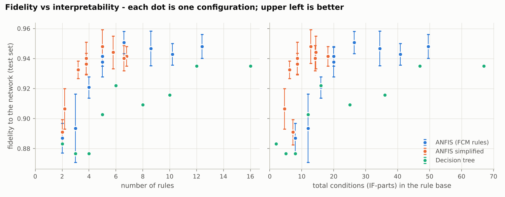
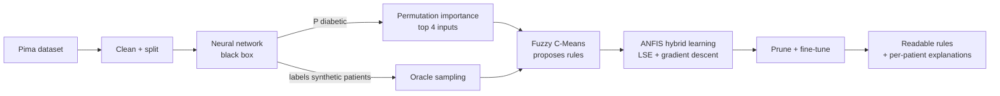
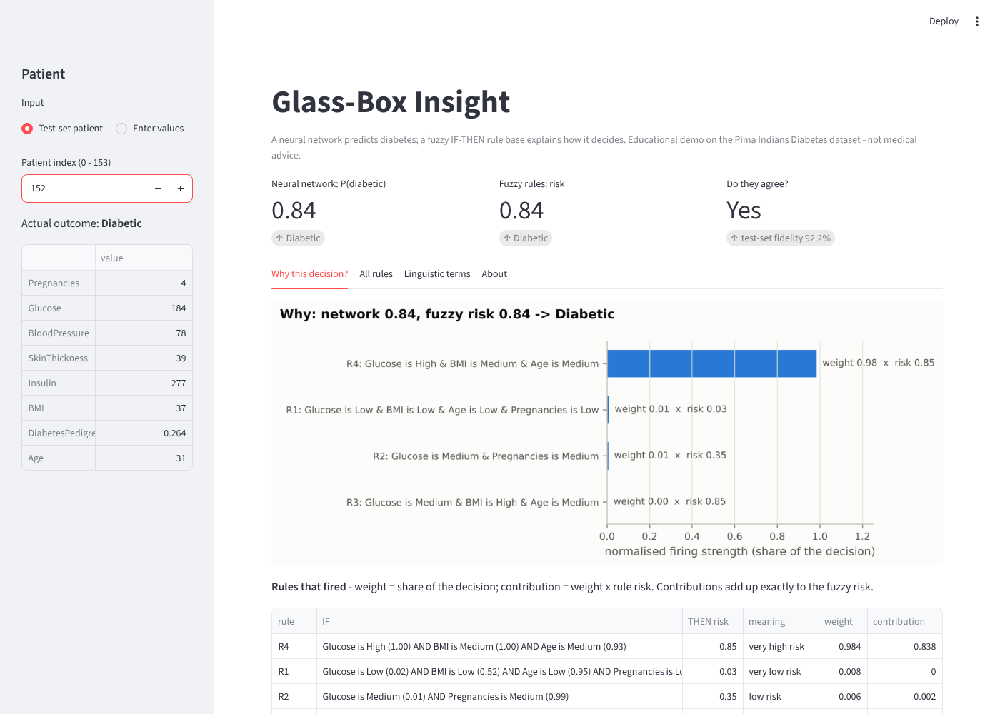

# Glass-Box Insight

**Fuzzy rule extraction for explaining black-box neural network decisions.**

A neural network predicts diabetes from 8 clinical measurements. We treat it as
a black box and train an ANFIS (Adaptive Neuro-Fuzzy Inference System) to
**imitate the network** with a handful of readable IF-THEN rules. Every
prediction can then be traced to the rules that produced it, for example:

> **IF** Glucose is High (~155 mg/dL) **AND** BMI is Medium (~37) **AND** Age is Medium (~35 yrs)
> **THEN** risk = 0.85 (very high risk)
>
> **IF** Glucose is Low (~102 mg/dL) **AND** BMI is Low (~29) **AND** Age is Low (~27 yrs)
> **AND** Pregnancies is Low **THEN** risk = 0.03 (very low risk)

_Course project for Fuzzy Logic and Neural Networks (B.Tech, final year)._

## Headline results

Test set of 154 patients that were never used for training, tuning or pruning.

| | Result |
|---|---|
| Black-box network (MLP 8→8→1) | 70.1 % accuracy, ROC-AUC 0.80 (logistic regression: 70.8 %, 0.82) |
| Fuzzy explainer, before pruning | 8 rules, 32 conditions, **94.8 % fidelity** to the network |
| Fuzzy explainer, after pruning | 4 rules, 12 conditions, **92.2 % fidelity** |
| Same setting averaged over 5 seeds | pruning: 26.4 → 12.8 conditions, fidelity 95.1 % → 94.8 % |
| Decision-tree explainer, 8 leaves | 25 conditions, 90.9 % fidelity |
| Grid ANFIS (all combinations) | 81 rules, 324 conditions, 94.2 % fidelity |

Findings:

- **Pruning roughly halves the rule base** with almost no loss of fidelity (seed average).
- **At every rule-base size the fuzzy explainer is more faithful than a decision
  tree** of the same size.
- **Interpretability constraints are free:** removing them does not raise fidelity
  (94.2 % vs 94.8 %), but terms then drift by about half the input range and
  swap order in 2 of 5 runs, so "Low" stops meaning low.
- **Imitating the network matters:** the same system trained on true labels agrees
  with the network only 88.2 % of the time.
- **Oracle sampling** (synthetic patients labelled by the network) adds 1.3
  points of fidelity.
- The explainer is honest about its limits: 15 % of test patients have no
  well-matching rule, and their explanations are flagged as weak.

Full tables: [results/summary.md](results/summary.md) · rules:
[results/rules.md](results/rules.md) · worked examples:
[results/case_studies.md](results/case_studies.md)



## How it works



1. **Black box** - an MLP tuned by 5-fold cross-validation (`glassbox/blackbox.py`).
2. **Which inputs matter** - permutation importance on the network's output (`glassbox/feature_selection.py`).
3. **Linguistic terms** - Low / Medium / High Gaussian membership functions per input, with shoulders at both ends (`glassbox/membership.py`).
4. **Rule proposals** - Fuzzy C-Means clusters of (inputs, network output), translated into words (`glassbox/fcm.py`, `glassbox/rulebase.py`).
5. **ANFIS** - zero-order Takagi-Sugeno system trained by hybrid learning to copy the network's probabilities, with constraints that keep the words meaningful (`glassbox/anfis.py`).
6. **Oracle sampling** - extra synthetic patients labelled by the network (`glassbox/oracle.py`).
7. **Simplification** - greedy pruning of conditions and rules, then fine-tuning (`glassbox/simplify.py`).
8. **Explanations** - the output is exactly the sum of per-rule contributions; weak rule matches are flagged (`glassbox/explain.py`).
9. **Evaluation** - fidelity, accuracy and rule-base complexity; trade-off sweep, decision-tree baseline and ablations (`scripts/run_experiments.py`).

The equations are in [docs/METHODOLOGY.md](docs/METHODOLOGY.md).

## Quick start

```bash
python -m venv .venv
source .venv/bin/activate          # Windows: .venv\Scripts\activate
pip install -r requirements.txt

python -m pytest                   # 20 unit tests, a few seconds
python scripts/run_experiments.py  # all results -> results/ (~5 min; --quick for 1 seed)
streamlit run app.py               # interactive demo in the browser
```

Python 3.9+ is required. No GPU is needed; everything runs on a laptop CPU.



## Repository layout

```
glassbox/               the library
  config.py             all settings in one place
  data.py               loading, cleaning (impossible zeros), 60/20/20 split
  blackbox.py           MLP + cross-validated tuning
  feature_selection.py  permutation importance
  membership.py         Gaussian membership functions, Low/Medium/High
  fcm.py                Fuzzy C-Means from scratch
  rulebase.py           rule representation, grid and FCM rule generation
  anfis.py              ANFIS: 5 layers, hybrid learning, constraints
  simplify.py           rule pruning
  oracle.py             synthetic data labelled by the network
  surrogates.py         decision-tree baseline
  metrics.py            fidelity, accuracy, interpretability measures
  rules.py              rules as sentences and tables
  explain.py            per-patient explanations
  plots.py              figures
  pipeline.py           end-to-end training used by the script and the app
scripts/run_experiments.py   reproduces every number and figure
app.py                  Streamlit demo
tests/                  unit tests (incl. numerical gradient check)
results/                generated tables, rules, case studies, figures
docs/
  PROBLEM_STATEMENT.md  revised problem statement, related work, references
  METHODOLOGY.md        every step with equations (report-ready)
  VIVA_GUIDE.md         pitch, team split, demo script, 38 Q&A
data/diabetes.csv       Pima Indians Diabetes dataset
```

## Documentation

- [Problem statement and references](docs/PROBLEM_STATEMENT.md)
- [Methodology](docs/METHODOLOGY.md)
- [Viva guide](docs/VIVA_GUIDE.md)

## Disclaimer

Educational project. The models were trained on 768 patients from a single
population and must not be used for medical decisions.
