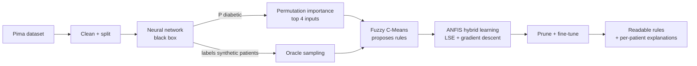

# Glass-Box Insight

**Fuzzy rule extraction for explaining black-box neural network decisions.**

A neural network predicts diabetes from 8 clinical measurements. We treat it as
a black box and train an ANFIS (Adaptive Neuro-Fuzzy Inference System) to
**imitate the network** with a handful of readable IF-THEN rules. Every
prediction can then be traced to the rules that produced it, for example:

> **IF** Glucose is High (~155 mg/dL) **AND** BMI is Medium (~37) **AND** Age is Medium (~35 yrs)
> **THEN** risk = 0.85 (very high risk)
>
> **IF** Glucose is Low (~102 mg/dL) **AND** BMI is Low (~29) **AND** Age is Low (~27 yrs)
> **AND** Pregnancies is Low **THEN** risk = 0.03 (very low risk)

_Course project for Fuzzy Logic and Neural Networks (B.Tech, final year)._

## Headline results

Test set of 154 patients that were never used for training, tuning or pruning.

**The black box:** an MLP (8→8→1) with 70.1 % accuracy and ROC-AUC 0.80
(logistic regression: 70.8 %, 0.82).

**The fuzzy explainer**, fidelity = share of test patients where it makes the
same decision as the network:

| | Rules | Conditions | Fidelity |
|---|---|---|---|
| Main model (seed 42), before pruning | 8 | 32 | 94.8 % |
| Main model (seed 42), after pruning | 4 | 12 | 92.2 % |
| 5 other seeds, before pruning (mean ± sd) | 6.6 ± 0.9 | 26.4 ± 3.6 | 95.1 % ± 0.7 |
| 5 other seeds, after pruning (mean ± sd) | 5.0 ± 1.6 | 12.8 ± 5.0 | 94.8 % ± 1.1 |

Compare rows within the same seeds. The main model is the one shown in the rules,
case studies and demo; it happened to prune harder than average.

**Baselines at equal size:**

| Explainer | Rules | Conditions | Fidelity |
|---|---|---|---|
| Decision tree, 4 leaves | 4 | 8 | 87.7 % |
| Decision tree, 5 leaves | 5 | 12 | 90.3 % |
| Grid ANFIS (every term combination) | 81 | 324 | 94.2 % |

Findings:

- **Pruning roughly halves the rule base** (26 → 13 conditions on average) for
  about 0.3 points of fidelity.
- **At equal size the fuzzy explainer is more faithful than a decision tree.**
- **Interpretability constraints are free:** removing them does not raise fidelity
  (94.2 % vs 94.8 %), but terms then drift by about half the input range and
  swap order in 2 of 5 runs, so "Low" stops meaning low.
- **Imitating the network matters:** the same system trained on true labels agrees
  with the network only 88.2 % of the time.
- **Constant THEN-parts are enough:** linear (first-order) THEN-parts were not more
  faithful (94.3 %) and need 18 numbers after THEN instead of 5.
- **Oracle sampling** (synthetic patients labelled by the network) adds 1.3
  points of fidelity.
- **The explainer is honest about its limits:** 15 % of test patients have no
  well-matching rule, and their explanations are flagged as weak.

Full tables: [results/summary.md](results/summary.md) · rules:
[results/rules.md](results/rules.md) · worked examples:
[results/case_studies.md](results/case_studies.md)


## How it works



1. **Black box** - an MLP tuned by 5-fold cross-validation (`glassbox/blackbox.py`).
2. **Which inputs matter** - permutation importance on the network's output (`glassbox/feature_selection.py`).
3. **Linguistic terms** - Low / Medium / High Gaussian membership functions per input, with shoulders at both ends (`glassbox/membership.py`).
4. **Rule proposals** - Fuzzy C-Means clusters of (inputs, network output), translated into words (`glassbox/fcm.py`, `glassbox/rulebase.py`).
5. **ANFIS** - zero-order Takagi-Sugeno system trained by hybrid learning to copy the network's probabilities, with constraints that keep the words meaningful (`glassbox/anfis.py`).
6. **Oracle sampling** - extra synthetic patients labelled by the network (`glassbox/oracle.py`).
7. **Simplification** - greedy pruning of conditions and rules, then fine-tuning (`glassbox/simplify.py`).
8. **Explanations** - the output is exactly the sum of per-rule contributions; weak rule matches are flagged (`glassbox/explain.py`).
9. **Evaluation** - fidelity, accuracy and rule-base complexity; trade-off sweep, decision-tree baseline and ablations (`scripts/run_experiments.py`).

The equations are in [docs/METHODOLOGY.md](docs/METHODOLOGY.md).

## Setting up on your computer

You need **Python 3.10 or newer** (tested on 3.10 and 3.13) and **Git**. No GPU;
any laptop works. Everything below is typed in a terminal: *PowerShell* on
Windows, *Terminal* on macOS or Linux.

### 1. Check Python and Git

```bash
python --version      # Windows: if this fails, try  py --version
git --version
```

If Python is missing, install it from [python.org](https://www.python.org/downloads/).
On Windows, tick **"Add python.exe to PATH"** in the installer. If Git is missing,
install it from [git-scm.com](https://git-scm.com/downloads).

### 2. Download the project

The repository is **private**. First the owner (`rakshit1862005`) adds you under
*Settings → Collaborators → Add people*, and you accept the invite while signed
in to GitHub. Then:

```bash
git clone https://github.com/rakshit1862005/Fuzzy_Project.git
cd Fuzzy_Project
```

A browser window opens for you to sign in to GitHub. GitHub no longer accepts
your account password at a Git prompt: if Git asks for a password instead, paste
a personal access token (<https://github.com/settings/tokens>, classic token with
the `repo` scope).

No Git? Sign in on github.com, open the repository, choose **Code → Download ZIP**,
extract it and `cd` into the extracted folder.

### 3. Create a virtual environment (a private folder of packages for this project)

Windows (PowerShell):

```powershell
py -m venv .venv
.venv\Scripts\Activate.ps1
```

macOS / Linux:

```bash
python3 -m venv .venv
source .venv/bin/activate
```

Your prompt now starts with `(.venv)`. Run the activate line again every time
you open a new terminal.

### 4. Install the packages

```bash
python -m pip install --upgrade pip
python -m pip install -r requirements.txt
```

### 5. Check that everything works

```bash
python -m pytest
```

Expected: `22 passed` in a few seconds.

### 6. Start the demo

```bash
python -m streamlit run app.py
```

Your browser opens at <http://localhost:8501>. The first load takes 15-30
seconds while the models train. Stop the app with `Ctrl+C` in the terminal.

### 7. (Optional) Regenerate all results

```bash
python scripts/run_experiments.py           # about 5-10 minutes
python scripts/run_experiments.py --quick   # 1 seed instead of 5, about 2 minutes
```

This rewrites everything in `results/`. The numbers should match the committed
ones; library versions can change the last digit.

### Troubleshooting

| Problem | Fix |
|---|---|
| `git clone` fails: *Invalid username or token. Password authentication is not supported* | (1) Make sure the owner invited your GitHub account and you accepted. (2) Remove the old saved login: `cmdkey /delete:git:https://github.com` (Windows), or Control Panel → Credential Manager → Windows Credentials → remove the `github.com` entries. (3) Clone again and sign in through the browser window, or paste a personal access token as the password. |
| `python` is not recognised (Windows) | Use `py` instead of `python`, or reinstall Python with "Add to PATH" ticked. |
| `Activate.ps1 cannot be loaded because running scripts is disabled` | Run `Set-ExecutionPolicy -Scope CurrentUser RemoteSigned` once, then activate again. Or use Command Prompt: `.venv\Scripts\activate.bat`. |
| `streamlit` is not recognised | Use `python -m streamlit run app.py`, and check that `(.venv)` is active. |
| `ModuleNotFoundError: No module named 'glassbox'` | Run commands from the `Fuzzy_Project` folder (the one containing `app.py`). |
| `Port 8501 is already in use` | `python -m streamlit run app.py --server.port 8502` |
| VS Code shows import errors | `Ctrl+Shift+P` → *Python: Select Interpreter* → pick the one inside `.venv`. |


## Repository layout

```
glassbox/               the library
  config.py             all settings in one place
  data.py               loading, cleaning (impossible zeros), 60/20/20 split
  blackbox.py           MLP + cross-validated tuning
  feature_selection.py  permutation importance
  membership.py         Gaussian membership functions, Low/Medium/High
  fcm.py                Fuzzy C-Means from scratch
  rulebase.py           rule representation, grid and FCM rule generation
  anfis.py              ANFIS: 5 layers, hybrid learning, constraints
  simplify.py           rule pruning
  oracle.py             synthetic data labelled by the network
  surrogates.py         decision-tree baseline
  metrics.py            fidelity, accuracy, interpretability measures
  rules.py              rules as sentences and tables
  explain.py            per-patient explanations
  plots.py              figures
  pipeline.py           end-to-end training used by the script and the app
scripts/run_experiments.py   reproduces every number and figure
app.py                  Streamlit demo
tests/                  unit tests (incl. numerical gradient check)
results/                generated tables, rules, case studies, figures
docs/
  PROBLEM_STATEMENT.md  revised problem statement, related work, references
  METHODOLOGY.md        every step with equations (report-ready)
  VIVA_GUIDE.md         pitch, team split, demo script, 42 Q&A
data/diabetes.csv       Pima Indians Diabetes dataset
```

## Documentation

- [Problem statement and references](docs/PROBLEM_STATEMENT.md)
- [Methodology](docs/METHODOLOGY.md)
- [Viva guide](docs/VIVA_GUIDE.md)

## Disclaimer

Educational project. The models were trained on 768 patients from a single
population and must not be used for medical decisions.
