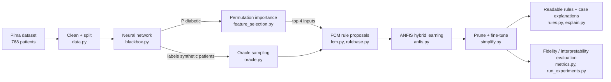

# Methodology

This document describes every step of the pipeline with the equations used and
the file that implements it. It is written so that it can be copied into the
project report.

## 1. Data preparation (`glassbox/data.py`)

- **Dataset:** Pima Indians Diabetes, 768 patients, 8 numeric inputs, binary
  outcome (35 % diabetic).
- **Split:** stratified 60 % train (460) / 20 % validation (154) / 20 % test (154).
  The test set is used only for the final numbers.
- **Missing values:** a 0 in Glucose, BloodPressure, SkinThickness, Insulin or BMI
  is physically impossible and means "not measured" (Insulin has 374 such zeros).
  Each is replaced by the median of the non-zero *training* values, so nothing
  leaks from validation or test patients.
- Values stay in original units so rules can be read as "Glucose ≈ 150 mg/dL".

## 2. Black-box neural network (`glassbox/blackbox.py`)

A multilayer perceptron: standardised inputs → ReLU hidden layer(s) → sigmoid
output giving P(diabetic). It is trained with backpropagation and the Adam
optimiser on cross-entropy loss plus an L2 weight penalty α‖W‖².

Hyperparameters (hidden layers ∈ {(8), (16), (16,8), (32,16)}, α ∈ {0.001,
0.01, 0.1, 1}) are chosen by 5-fold cross-validated ROC-AUC on the training
set. Early stopping was tried and dropped: its internal hold-out (15 % of 460 ≈
70 patients) was too small and made results unstable.

After training, the network is used **only through its predictions**.

## 3. Choosing the fuzzy system's inputs (`glassbox/feature_selection.py`)

A rule over all 8 inputs is too long to read, so the fuzzy system uses the
network's 4 most important inputs. Importance of feature j is measured by
**permutation importance on the network's output**:

$$I_j = \frac{1}{R}\sum_{r=1}^{R} \operatorname{mean}_n \left| f_{NN}(x_n^{(j\,\text{shuffled}, r)}) - f_{NN}(x_n) \right|$$

Shuffling a column destroys its information while keeping its distribution;
the more the network's output moves, the more the network relies on it.

## 4. Linguistic terms (`glassbox/membership.py`)

Each selected input is min-max scaled to [0, 1] and covered by three Gaussian
terms, **Low, Medium, High**:

$$\mu_{jt}(x_j) = \exp\left(-\frac{(x_j - c_{jt})^2}{2\sigma_{jt}^2}\right)$$

Initial centres sit at the 10 %, 50 % and 90 % quantiles of the training data;
widths are set so that neighbouring terms cross at μ = 0.5
(σ = gap / (2√(2 ln 2))). All rules **share** the same terms, so "Glucose is
High" means the same thing in every rule.

## 5. Proposing rules with Fuzzy C-Means (`glassbox/fcm.py`, `glassbox/rulebase.py`)

A grid of all term combinations needs 3⁴ = 81 rules for 4 inputs (3⁸ = 6561 for
all 8), which nobody can read. Instead, FCM clusters the training points in the
joint space *(inputs, network output)*, so each cluster is a group of similar
patients who get a similar decision. FCM minimises

$$J_m = \sum_{k=1}^{N}\sum_{i=1}^{c} u_{ik}^m \lVert x_k - v_i \rVert^2,\quad \sum_i u_{ik} = 1$$

by alternating

$$v_i = \frac{\sum_k u_{ik}^m x_k}{\sum_k u_{ik}^m}, \qquad
u_{ik} = \left[\sum_{j=1}^{c}\left(\frac{\lVert x_k - v_i\rVert}{\lVert x_k - v_j\rVert}\right)^{2/(m-1)}\right]^{-1}$$

with fuzzifier m = 2. Each cluster centre becomes one rule: for each input we
pick the term with the highest membership at the centre. Duplicate rules are
merged, so c clusters give at most c rules.

## 6. ANFIS with hybrid learning (`glassbox/anfis.py`)

We use a **zero-order Takagi-Sugeno** system: each rule outputs a single number,
which is far easier to read than a linear formula.

$$R_r:\ \text{IF } x_1 \text{ is } A_{r1} \text{ AND } \dots \text{ AND } x_k \text{ is } A_{rk} \text{ THEN } y = p_r$$

| Layer | Operation |
|---|---|
| 1. Fuzzification | $\mu_{jt}(x_j)$ |
| 2. Rule firing (AND = product) | $w_r = \prod_{j \in R_r} \mu_{j,A_{rj}}(x_j)$ |
| 3. Normalisation | $\bar w_r = w_r / \sum_q w_q$ |
| 4. Consequent | $\bar w_r\, p_r$ |
| 5. Output | $y = \sum_r \bar w_r\, p_r$ |

Products are computed as sums of logarithms to avoid numerical underflow.

**Training target.** The surrogate is trained to reproduce the network's
*probability* $f_{NN}(x)$ (a soft target), not the 0/1 label, using mean squared
error $L = \frac1N\sum_n (y_n - f_{NN}(x_n))^2$. Soft targets carry more
information: they tell the surrogate how sure the network is.

**Hybrid learning** (Jang, 1993), each epoch:

1. *Forward pass* - with the premise parameters (c, σ) fixed, y is linear in p,
   so the optimal p is found by regularised least squares:
   $$p = (\bar W^\top \bar W + \lambda I)^{-1}(\bar W^\top t + \lambda \bar t)$$
   λ = 1 acts like one imaginary average patient per rule, so rarely-firing
   rules get a neutral output. p is clipped to [0, 1].
2. *Backward pass* - with p fixed, update c and σ by gradient descent (Adam).
   Using $\partial y/\partial \theta = \sum_r \bar w_r (p_r - y)\,\partial \log w_r/\partial\theta$:
   $$\frac{\partial L}{\partial c_{jt}} = \sum_n \sum_{r:\,A_{rj}=t} G_{nr}\,\frac{x_{nj}-c_{jt}}{\sigma_{jt}^2},\qquad
     \frac{\partial L}{\partial \sigma_{jt}} = \sum_n \sum_{r:\,A_{rj}=t} G_{nr}\,\frac{(x_{nj}-c_{jt})^2}{\sigma_{jt}^3}$$
   with $G_{nr} = \frac{2}{N}(y_n - t_n)\,\bar w_{nr}\,(p_r - y_n)$.
   These hand-derived gradients are verified against numerical differentiation
   in `tests/test_anfis.py`.

**Interpretability constraints**, applied after every update:

- each centre stays within ±0.1 of the input range of its starting position, so
  "Low" stays low;
- centres stay ordered, Low < Medium < High, at least 0.05 apart;
- each width stays between ½× and 2× its starting value.

**Early stopping:** the parameters from the epoch with the lowest validation
error are kept.

## 7. Oracle sampling (`glassbox/oracle.py`)

Because the target is the network's output, we can create more training data:
2,000 synthetic patients are made by adding Gaussian noise (0.15 × feature std)
to random real training patients, clipped to the observed range, and labelled
by the network (Craven & Shavlik, 1996). The validation pool is enlarged the
same way (1,000 points around validation patients), which makes early stopping
and pruning decisions less sensitive to individual patients.

## 8. Simplification (`glassbox/simplify.py`)

Greedy pruning, first of single conditions and then of whole rules. At each
step, every possible deletion is tried (rule outputs re-fitted by least
squares), and the best one is kept if:

- fidelity on the validation pool falls by at most 1 percentage point overall, and
- the squared error to the network's probabilities grows by at most 25 %.

The second check matters. Fidelity only counts flipped decisions, so without
it pruning pushes many patients towards the 0.5 threshold, and those flip on
new data. Without the check, test fidelity after pruning averaged 92 % instead
of 94 %. Rules that become identical are merged. Finally the pruned rule base
is fine-tuned for 100 more epochs under the same constraints.

## 9. Explanations (`glassbox/explain.py`, `glassbox/rules.py`)

Because $y = \sum_r \bar w_r p_r$, the contribution of rule r to a prediction is
exactly $\bar w_r p_r$. These contributions sum to the output, so an explanation
lists the strongest rules, the membership degree of each of their conditions,
and their share of the final risk. Nothing is left unexplained.

## 10. Evaluation (`glassbox/metrics.py`, `scripts/run_experiments.py`)

| Measure | Definition |
|---|---|
| Fidelity | share of test patients where fuzzy decision = network decision |
| Boundary fidelity | fidelity on patients with network probability in (0.35, 0.65) |
| Probability MAE | mean \|fuzzy risk − network probability\| |
| Accuracy, F1, ROC-AUC | against the true diagnosis |
| Rules | number of rules |
| Conditions | total number of "x is T" conditions (total rule length) |

Experiments:

1. **Trade-off sweep** - FCM cluster counts 2 to 16, 5 random seeds each,
   before and after simplification, compared with a decision tree trained on the
   network's labels and limited to the same number of leaves.
2. **Grid ANFIS** (all term combinations) as the classical reference.
3. **Ablations** - without oracle sampling, without interpretability
   constraints, and trained on true labels instead of the network.
4. **Number of inputs** - 2 to 6 features.
5. **Case studies** - a confident diabetic, a confident non-diabetic, a borderline
   patient and (if any) a disagreement between the fuzzy system and the network.
