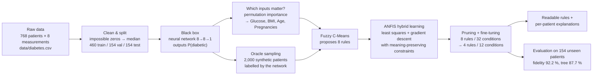

# Chapter 1 · Executive Overview

[← Guide index](README.md) · [Next: Problem statement →](02-problem-statement.md)

> **How to read the evidence labels in this guide**
> - ✅ **Verified**: checked against the code, the data or a committed result file.
> - 🔎 **Interpretation**: a conclusion the evidence supports but no file states directly.
> - ❓ **Unknown**: cannot be established from the project materials.

---

## 1.1 The project in plain English

A computer program (a **neural network**) has learned to look at eight medical
measurements of a woman (her blood-sugar level, weight-for-height, age, number
of pregnancies, and so on) and say how likely it is that she has diabetes. It is
reasonably good at this, but it cannot say *why*. Its "reasoning" is stored as 81
numbers that mean nothing to a person.

Our project builds a second program that **watches the first one and learns to
copy its decisions using a few sentences a doctor can read**, such as:

> IF glucose is High AND BMI is Medium AND age is Medium THEN risk is about 0.85.

This second program is a **fuzzy rule system** whose rules and word meanings are
tuned automatically from data, a **neuro-fuzzy system**. Once it copies the
first program well, we can point at any decision and say *which sentence caused
it*.

## 1.2 The questions an outsider would ask

| Question | Short answer |
|---|---|
| **What is the project?** | A tool that explains a "black-box" neural network's diabetes predictions with a small set of readable IF-THEN rules. |
| **What problem does it solve?** | Neural networks predict but do not explain. In medicine, an unexplained decision is hard to trust, check or challenge. |
| **Why is it difficult?** | The network's decision depends on all inputs at once in a curved, non-linear way. Any short rule list is a *simplification*, so it will sometimes disagree with the network. Making rules shorter makes them easier to read but usually less faithful. |
| **What is the basic idea?** | Treat the network as an oracle you can ask questions. Train a fuzzy system to give the same answers (not the true diagnoses), then simplify it as much as possible without losing faithfulness. |
| **What does the neuro-fuzzy part contribute?** | *Fuzzy*: rules in words with soft boundaries ("glucose is *somewhat* High"). *Neuro*: the word meanings and rule outputs are learned from data by optimisation, like a neural network, instead of being written by hand. |
| **What have we actually built?** | A complete working pipeline in Python, a reproducible experiment script, unit tests, and an interactive web "lab" that trains everything live. ✅ |
| **Results?** | The final 4-rule system makes the same decision as the network for **92.2 %** of 154 unseen patients (142 of 154). A same-size decision tree manages 87.7 %. ✅ |
| **Limitations?** | One small dataset; the network itself is only about as accurate as simple logistic regression (70.1 %); some learned terms overlap heavily; no doctor has evaluated the rules; the test set is small. ✅ (details in [Chapter 11](11-results-critique.md)) |

## 1.3 One-paragraph explanation

We trained a small neural network (8 inputs, 8 hidden neurons, 1 output) to
predict diabetes on the Pima Indians Diabetes dataset (768 patients). We then
treated the network as a black box and trained an **ANFIS** (Adaptive
Neuro-Fuzzy Inference System, a fuzzy rule system whose parameters are learned
like a neural network's) to reproduce the network's predicted probabilities from
its four most important inputs. **Fuzzy C-Means clustering** proposes the
initial rules. ANFIS then tunes them with **hybrid learning**: least squares for
the rule outputs and gradient descent for the membership functions, under
constraints that keep "Low", "Medium" and "High" meaningful. Finally, a
**pruning** step deletes every condition and rule that is not needed. The result
is a 4-rule, 12-condition rule base that agrees with the network on 92.2 % of
unseen test patients. Every prediction can be decomposed exactly into the
contributions of individual rules.

## 1.4 One-minute viva explanation (to be spoken)

> "Neural networks are accurate but opaque: they cannot say why they decided.
> Fuzzy rule systems are the opposite: anyone can read 'IF glucose is high THEN
> risk is high', but they are weaker at learning from data. Our project combines
> them. We trained a neural network on the Pima diabetes data and treated it as a
> black box. Then we trained a neuro-fuzzy system, an ANFIS, to *copy the
> network's answers*, not the real diagnoses, so its rules describe the network.
> Fuzzy C-Means proposes the rules, hybrid learning tunes them, constraints keep
> the words meaningful, and pruning removes unnecessary conditions. The final
> system has four short rules and agrees with the network on 92 % of patients it
> has never seen; a decision tree of the same size reaches 88 %. For any patient
> we can show exactly which rule produced the decision, and the system warns us
> when no rule describes a patient well."

## 1.5 A real-world analogy

Imagine an **experienced senior doctor** who is very good at spotting diabetes
but cannot put her reasoning into words: she "just knows". A **medical student**
follows her for weeks, writes down what she decides for each patient, and tries
to summarise her behaviour as a few rules of thumb: "When the sugar is high and
the patient is middle-aged and somewhat overweight, she almost always says
diabetic."

- The senior doctor is the **neural network** (accurate, but unexplained).
- The student's notebook of rules of thumb is the **fuzzy rule base**.
- "Somewhat overweight" is a **fuzzy term**: it has no sharp cut-off.
- The student checks the notebook against new patients: *how often would the
  notebook have predicted what the doctor actually said?* That percentage is
  **fidelity**.
- The student is not trying to be a better doctor. The goal is to describe the
  senior doctor faithfully. If the senior doctor has a blind spot, a faithful
  notebook will show it, and that is useful.
- The student may also ask the doctor about imaginary patients ("what would you
  say if this patient were five years older?"). That is our **oracle sampling**.

Where the analogy breaks: the network is a mathematical function, not a person,
and we can query it as often as we like at no cost.

## 1.6 The complete system at a glance

The same pipeline is run by `scripts/run_experiments.py` (all report results)
and by the live lab `python -m webapp` (interactive demo). Both call
`glassbox/pipeline.py`, so they build identical models. ✅

## 1.7 How problem, method, implementation and results fit together

| Layer | In one line |
|---|---|
| **Problem** | A neural network's diabetes predictions cannot be explained. |
| **Method** | Learn a small fuzzy rule base that imitates the network (a *global surrogate*), and measure how faithful and how simple it is. |
| **Implementation** | Python package `glassbox/`: MLP black box → permutation importance → Fuzzy C-Means rules → ANFIS with hybrid learning and constraints → pruning → explanations and evaluation. |
| **Results** | 4 rules, 12 conditions, 92.2 % fidelity on unseen patients (94.8 % ± 1.1 averaged over five other seeds), more faithful than a same-size decision tree, with exact per-patient explanations. |
| **Honest limits** | One dataset, a modest black box, some overlapping terms, a small test set, no clinician evaluation, and a decision-tree baseline that was trained on less data. |

[Next: Chapter 2 · The problem statement →](02-problem-statement.md)
