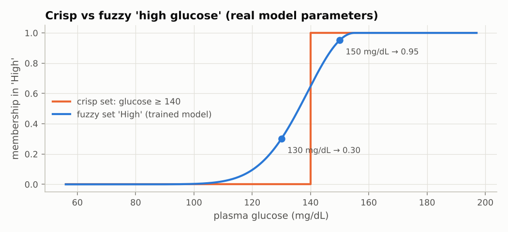
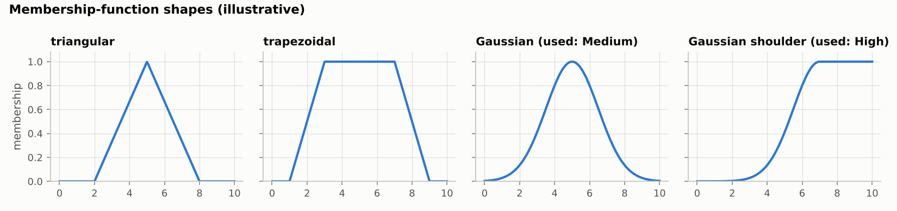
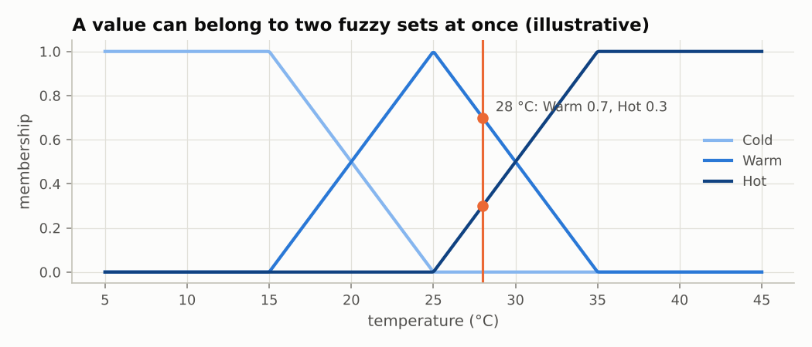
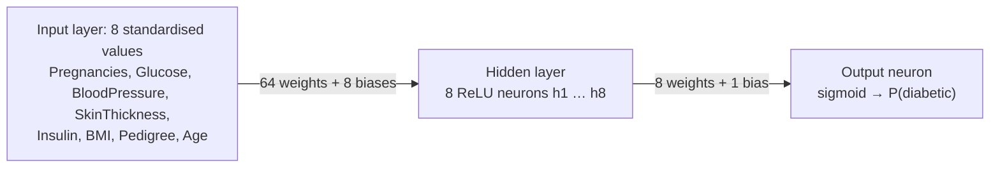
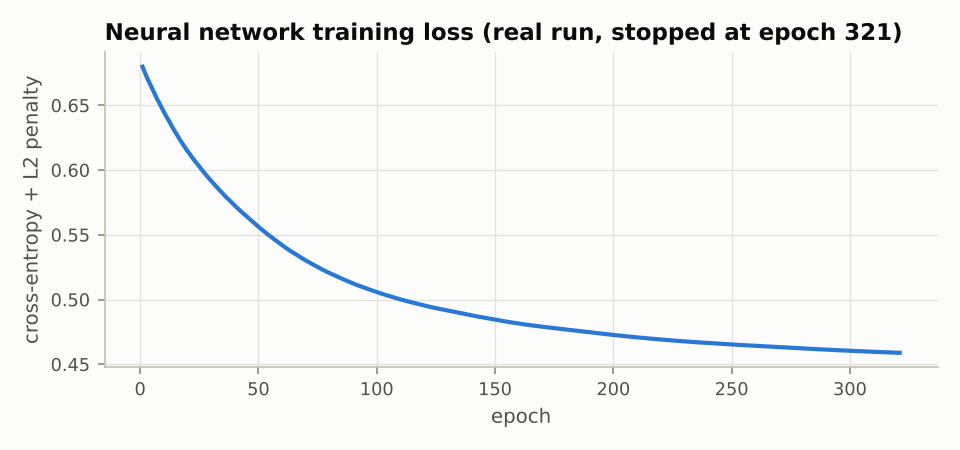
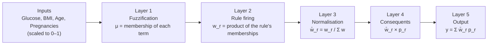

# Chapter 3 · Background Concepts from Scratch

[← Chapter 2](02-problem-statement.md) · [Guide index](README.md) · [Next: Existing approaches →](04-existing-approaches.md)

This chapter assumes no prior knowledge. Each concept follows the same pattern:
**definition → plain English → analogy → example → maths → where it appears in
our project → why it matters.** Skip any section you already know.

---

## Part A · Foundations of machine learning

### 3.1 Features, inputs, outputs, targets

- **Definition.** A *feature* (input variable) is one measured property of an
  example. The *target* (output variable) is the quantity we want to predict.
- **Plain English.** Features are the columns you look at; the target is the
  column you want to guess.
- **Analogy.** A doctor's form: the boxes the nurse fills in are features; the
  diagnosis at the bottom is the target.
- **Our project.** 8 features per patient (Pregnancies, Glucose, BloodPressure,
  SkinThickness, Insulin, BMI, DiabetesPedigreeFunction, Age) and the target
  `Outcome` (1 = diabetic, 0 = not). ✅ (`glassbox/config.py`, `FEATURES`, `TARGET`)
- **Notation.** One patient is a vector $x = (x_1, \dots, x_8)$; the target is $y \in \{0, 1\}$.

### 3.2 Dataset, training examples

- **Definition.** A dataset is a set of $N$ examples $(x^{(n)}, y^{(n)})$, $n = 1 \dots N$.
- **Our project.** $N = 768$ rows in `data/diabetes.csv`, each one woman of Pima
  heritage aged 21 or over. ✅ (`data/README.md`)

### 3.3 Functions and non-linear relationships

- **Definition.** A model is a function $\hat y = f(x; \theta)$ that maps inputs to
  a prediction, where $\theta$ are adjustable numbers (parameters).
- **Linear vs non-linear.** A linear function adds weighted inputs:
  $f(x) = w_1 x_1 + w_2 x_2 + b$. Doubling the glucose effect is then always the
  same, whatever the BMI. A **non-linear** function lets effects interact: high
  glucose might matter more for an older patient. Neural networks and fuzzy rule
  systems are both non-linear.
- **Why it matters.** Diabetes risk is plausibly non-linear (thresholds,
  interactions), which is why a network is used at all, and why a short list of
  rules can only *approximate* it.

### 3.4 Parameters vs hyperparameters vs architecture

| Concept | Definition | Example in our project |
|---|---|---|
| **Parameter** | A number the training algorithm learns. | Network weights; membership-function centres $c$ and widths $\sigma$; rule outputs $p$. |
| **Hyperparameter** | A setting chosen *before* training. | Number of hidden neurons (8), L2 penalty α (1.0), number of FCM clusters (8), terms per input (3), ANFIS learning rate (0.01), epochs (300). ✅ `config.py` |
| **Architecture** | The structure of the model. | MLP 8→8→1; ANFIS with 4 inputs, 3 terms each, a set of rules. |

Hyperparameters are chosen by trying several values and comparing validation
results (§3.7). Our network's size and α were picked by 5-fold
cross-validation; most fuzzy hyperparameters were set by hand and then studied
in sweeps.

### 3.5 Training vs inference

- **Training:** adjusting parameters so the model fits known examples. Slow, done once.
- **Inference:** using the trained model on a new input. Fast, done many times.
- In the live lab, *Train* is training; moving a slider in *Explore* is inference.

### 3.6 Loss functions and optimisation

- **Definition.** A *loss* $L(\theta)$ is a number measuring how wrong the
  model is on the training data. *Optimisation* means finding parameters that
  make $L$ small.
- **Two losses in our project:**
  - **Cross-entropy** for the network:
    $L = -\frac1N\sum_n \big[y_n \log \hat y_n + (1-y_n)\log(1-\hat y_n)\big]$,
    plus an L2 penalty (§3.18). It punishes confident wrong answers heavily.
    Example: if the truth is 1 and the network says 0.525, the loss term is
    $-\log 0.525 = 0.644$.
  - **Mean squared error** for ANFIS: $L = \frac1N\sum_n (y_n - t_n)^2$, where
    $t_n$ is the *network's* probability. It measures how far the fuzzy output
    is from the network.
- **Gradient descent:** repeatedly change each parameter a little in the
  direction that lowers the loss: $\theta \leftarrow \theta - \eta \,\partial L/\partial\theta$,
  where $\eta$ is the **learning rate** (step size).

### 3.7 Training, validation and test sets

| Split | Size | Used for | Never used for |
|---|---|---|---|
| Training | 460 | Fitting parameters, choosing network hyperparameters (CV inside it) | Final scores |
| Validation | 154 | Permutation importance, ANFIS early stopping, pruning decisions | Final scores |
| Test | 154 | **Only** the final numbers in the report | Any decision during training |

✅ (`glassbox/data.py`, `load_dataset`, stratified 60/20/20)

- **Why three sets?** If you tune decisions on the test set, the test score
  stops being an honest estimate of performance on new data.
- **Stratified** means each split keeps the same share of diabetic patients
  (about 35 %).
- **Cross-validation (5-fold):** split the training set into 5 parts; train on 4
  and score on the 5th, rotating, and average. Used to choose the network's size
  and α. ✅ (`glassbox/blackbox.py`, `tune_mlp`)

### 3.8 Generalisation, overfitting, underfitting

- **Generalisation:** doing well on data not seen in training.
- **Overfitting:** memorising training quirks; great training score, worse test
  score. *Analogy:* memorising last year's exam answers.
- **Underfitting:** the model is too simple to capture the pattern.
- **Defences used:** an L2 penalty on the network's weights, early stopping
  (keeping ANFIS parameters from the best *validation* epoch), small models, and
  evaluating only on the untouched test set.

---

## Part B · Fuzzy logic

### 3.9 Uncertainty vs imprecision (vagueness)

- **Uncertainty** (probabilistic): *we do not know* whether something is true.
  "There is a 30 % chance it will rain."
- **Imprecision / vagueness:** the thing is fully known, but the *category* has no
  sharp boundary. "Is 28 °C hot?" We know it is 28 °C; the word "hot" is vague.
- **Fuzzy logic models vagueness**, not chance. That distinction matters in the
  viva:

> A membership degree of 0.7 in "Warm" does **not** mean "70 % chance the
> temperature is warm". It means "28 °C is warm *to degree* 0.7". Nothing is
> random.

### 3.10 Boolean logic vs fuzzy logic; crisp sets vs fuzzy sets

- **Crisp set:** an element is in (1) or out (0). "Glucose ≥ 140 is high": 139 is
  not high, 140 is. A 1 mg/dL change flips the category.
- **Fuzzy set** (Zadeh, 1965): each element has a **membership degree**
  $\mu(x) \in [0, 1]$. 130 mg/dL can be "High" to degree 0.30 and 150 mg/dL to
  degree 0.95.

*Figure 3.1. Real model parameters: our trained "Glucose is High" term against a
crisp cut-off at 140 mg/dL. Generated by `scripts/make_guide_figures.py`.*

- **Why it matters for us:** rules built on fuzzy sets change their output
  *smoothly* as glucose rises, like the network does, instead of jumping at a
  threshold like a decision tree.

### 3.11 Membership functions and membership degrees

- **Definition.** A *membership function* $\mu_A(x)$ gives the degree to which
  value $x$ belongs to fuzzy set $A$.
- **What a degree means:** compatibility of a value with a word. 1 = fully
  "High", 0 = not at all, 0.5 = halfway.
- **What it does not mean:** a probability, a percentage of patients, or a
  confidence in the measurement.
- **Memberships across terms need not sum to 1.** In our model, BMI 37 is Low
  0.52, Medium 1.00 and High 0.53 (sum 2.05). ✅ (Chapter 12)

### 3.12 Common shapes

*Figure 3.2. Illustrative shapes.*

| Shape | Formula | Notes |
|---|---|---|
| Triangular | $\mu(x)=\max\!\big(0,\min(\frac{x-a}{b-a},\frac{c-x}{c-b})\big)$ | Simple, but has corners (no derivative there). |
| Trapezoidal | like a triangle with a flat top | Good for "anything in this range". |
| **Gaussian** (used for Medium) | $\mu(x)=\exp\!\big(-\frac{(x-c)^2}{2\sigma^2}\big)$ | Smooth everywhere, two parameters (centre $c$, width $\sigma$), so gradient descent can tune it. |
| **Gaussian shoulder** (used for Low and High) | flat at 1 beyond the centre, Gaussian on the other side | So a glucose of 200 is fully "High", not "less High than 155". |

**Worked example (illustrative): 28 °C is partly Warm and partly Hot.** With
triangles Warm = (15, 25, 35) and Hot = (25, 35, 45):
$\mu_{Warm}(28) = (35-28)/10 = 0.7$ and $\mu_{Hot}(28) = (28-25)/10 = 0.3$.

*Figure 3.3. Illustrative.*

**Worked example (real parameters):** our trained "Glucose is Medium" term has
centre 132.7 mg/dL and width σ = 15.8. For glucose 140:
$\mu = \exp\big(-\tfrac{(140-132.7)^2}{2\cdot 15.8^2}\big) = 0.90$. ✅

### 3.13 Linguistic variables and terms

- **Linguistic variable:** a variable whose values are words, such as *Glucose*.
- **Linguistic terms:** the words, *Low*, *Medium*, *High*, each defined by a
  membership function.
- **Our project:** 4 linguistic variables (Glucose, BMI, Age, Pregnancies), each
  with 3 terms, so 12 membership functions. All rules **share** the same 12
  definitions, so "Glucose is High" means the same thing in every rule. ✅
  (`glassbox/membership.py`, `TERM_NAMES`; `anfis.py`, `centers_` has shape 4×3)

### 3.14 Fuzzy IF-THEN rules

- **Form:** IF *antecedent* (the conditions) THEN *consequent* (the conclusion).
- **Example from our model:** IF Glucose is Medium AND Pregnancies is Medium THEN
  risk = 0.35. ✅ (`results/rules.md`, rule 2)
- **A rule does not need every input.** Rule 2 says nothing about BMI or Age
  ("don't care"). Pruning creates these shorter rules.

### 3.15 Fuzzification

Turning a crisp number into membership degrees for every term. Patient #152's
glucose of 184 becomes Low 0.02, Medium 0.01, High 1.00. ✅ (Chapter 12)

### 3.16 Fuzzy AND and OR: t-norms and t-conorms

- A **t-norm** generalises AND to degrees. Common choices are minimum,
  $\min(a,b)$, and product, $a \cdot b$.
- A **t-conorm** generalises OR, for example $\max(a,b)$.
- **Our project uses the product t-norm for AND** ✅ (`anfis.py`,
  `_log_firing`: it adds log-memberships, which equals multiplying memberships).
  Product is differentiable everywhere, so every condition gets a gradient. With
  min, only the smallest one would.
- **OR is not used:** all our rules are conjunctions (AND only). The final
  weighted average plays the role of combining rules.

### 3.17 Fuzzy inference, firing strength, aggregation, defuzzification

1. **Firing strength** $w_r$ of rule $r$: how strongly its IF-part is satisfied,
   the AND (product) of its conditions' memberships.
   *Example (illustrative):* IF Glucose is High (0.9) AND BMI is High (0.5) →
   $w = 0.9 \times 0.5 = 0.45$.
2. **Aggregation:** combine the rules' conclusions, weighted by firing strength.
3. **Defuzzification:** turn the combined result into one crisp number.

**Mamdani vs Sugeno (Takagi-Sugeno-Kang, TSK):**

| | Mamdani (1975) | Takagi-Sugeno (1985) |
|---|---|---|
| THEN-part | a fuzzy set: "risk is High" | a number or formula: "risk = 0.85" |
| Combining rules | merge the output fuzzy sets | weighted average of rule outputs |
| Defuzzification | needed (e.g. centroid of the merged set) | not needed: the weighted average is already a number |
| Differentiable, easy to learn? | harder | yes, which is why ANFIS uses it |
| Readability of THEN-part | very readable | readable if the output is a constant (zero-order) |

**Our project uses a zero-order Takagi-Sugeno system:** every THEN-part is a single
number, the risk. ✅ (`anfis.py`, `order=0` by default; first-order linear THEN-parts
exist only for an ablation experiment.)

---

## Part C · Neural networks

### 3.18 One artificial neuron

- **Definition.** A neuron computes $z = \sum_i w_i x_i + b$ (weighted inputs plus
  a bias), then applies an **activation function**: $a = g(z)$.
- **Plain English.** It adds up evidence, each piece with its own importance,
  then squashes or clips the total.
- **Illustrative example.** Inputs $x = (1, 2)$, weights $w = (0.5, -0.25)$, bias
  $b = 0.1$: $z = 0.5 - 0.5 + 0.1 = 0.1$. With a sigmoid $g(z) = 1/(1+e^{-z})$:
  $a = 0.525$.
- **Activations used in our network:** ReLU, $\max(0, z)$, in the hidden layer;
  sigmoid (logistic) at the output, so the output is a probability between 0 and 1. ✅
  (`blackbox.py`, `activation="relu"`; scikit-learn uses a logistic output for
  binary classification: `out_activation_ = "logistic"`)

### 3.19 Layers, forward propagation

Neurons are stacked in layers. **Forward propagation** passes the input through
every layer to get the output.

*Figure 3.4. Our actual network: 8 → 8 → 1, 81 parameters. ✅*

The inputs are **standardised** first (subtract the training mean, divide by the
standard deviation), so that glucose (around 120) does not dominate pregnancies
(around 4) just because of its units. ✅ (`StandardScaler` in `make_mlp`)

### 3.20 Backpropagation and gradient descent

- **Backpropagation** (Rumelhart, Hinton & Williams, 1986) applies the chain rule
  from the loss backwards through each layer to get $\partial L/\partial w$ for
  every weight.
- **Illustrative single step,** continuing §3.18 with true label $y = 1$:
  - prediction $a = 0.525$, loss $= -\log 0.525 = 0.644$;
  - for sigmoid with cross-entropy, $\partial L/\partial z = a - y = -0.475$;
  - $\partial L/\partial w_i = (a-y)\,x_i = (-0.475, -0.950)$;
  - with learning rate 0.1: $w \leftarrow (0.5, -0.25) - 0.1 \times (-0.475, -0.950) = (0.5475, -0.155)$;
  - the new prediction is 0.595: closer to the true value 1.
- **Adam** (Kingma & Ba, 2015), used by our network and by ANFIS: gradient
  descent with *momentum* (a running average of gradients) and an *adaptive step
  size* per parameter (scaled by a running average of squared gradients). ✅
  (`blackbox.py`, `solver="adam"`; `anfis.py`, class `Adam`)
- **L2 penalty (α):** adds $\frac{\alpha}{2}\sum w^2$ (divided by the batch size)
  to the loss, which discourages large weights and reduces overfitting.
  scikit-learn implements exactly this ✅ (checked in its source). Our network
  uses α = 1.0.
- **Mini-batches and epochs:** scikit-learn updates weights on batches of 200
  patients; one pass over all training data is an *epoch*. Our network ran 321
  epochs, stopping when the training loss improved by less than 0.0001 for more
  than 10 epochs in a row. ✅

*Figure 3.5. Real training run of our network.*

---

## Part D · Neuro-fuzzy systems

### 3.21 What a neuro-fuzzy system is

- **Definition.** A fuzzy inference system whose parameters (membership
  functions, rule outputs, sometimes the rules themselves) are **learned from data**
  with neural-network-style optimisation.
- **Plain English.** The *structure* is fuzzy rules a person can read; the
  *numbers inside* are tuned automatically, like a network's weights.
- **Analogy.** A recipe written in words ("add *some* salt, bake until *golden*")
  where the amounts and timings are fine-tuned by tasting many batches.

### 3.22 Fuzzy system vs neural network vs neuro-fuzzy

| | Hand-built fuzzy system | Neural network | Neuro-fuzzy (ANFIS) |
|---|---|---|---|
| Knowledge stored as | rules + membership functions written by experts | weights | rules + membership functions |
| Learned from data? | no | yes | yes |
| Human-readable? | yes | no | yes, if kept small and constrained |
| Typical weakness | does not scale; needs an expert | opaque | can lose readability if unconstrained; rule count can explode |
| Role in our project | not used | the black box to explain | the explainer |

### 3.23 ANFIS: the architecture we use

**ANFIS** (Adaptive-Network-based Fuzzy Inference System, Jang, 1993) writes a
Takagi-Sugeno fuzzy system as a 5-layer network:

| Layer | Learnable? | Our parameters |
|---|---|---|
| 1 | ✅ *premise parameters*: centres $c_{jt}$, widths $\sigma_{jt}$ | 4 inputs × 3 terms × 2 = 24 numbers |
| 2 | no (fixed product) | which terms each rule uses is fixed after FCM and pruning |
| 3 | no | – |
| 4 | ✅ *consequent parameters*: one $p_r$ per rule | 4 numbers in the final model |
| 5 | no | – |

**Hybrid learning:** consequents by least squares (exact), premises by gradient
descent. Explained in full in [Chapter 6](06-mathematics.md).

### 3.24 What "interpretability" means here

We call our rule base interpretable when:
1. it is **small** (few rules, few conditions per rule): measured ✅;
2. each term **keeps its meaning** (Low < Medium < High, centres near where they
   started): enforced by constraints and measured ✅;
3. every prediction can be **traced** to specific rules: exact decomposition ✅;
4. a domain expert **agrees the rules make sense**: ❓ not tested with experts.

Interpretability is partly subjective. We measure proxies (1–3), not
understanding itself (4).

### 3.25 Fuzzy C-Means in one paragraph

**Fuzzy C-Means** (Bezdek, 1981) clusters data like k-means, but each point
belongs to *every* cluster with a degree $u \in [0,1]$, and a point's degrees sum
to 1. We use it to propose rules: each cluster centre becomes one rule.
Explained with equations in [Chapter 6](06-mathematics.md).

### 3.26 Surrogate models and fidelity

- A **global surrogate** is an interpretable model trained to imitate a black-box
  model everywhere (Molnar, 2022).
- **Fidelity** = how often the surrogate agrees with the black box. It is *not*
  accuracy.

> **The single most important distinction in this project:** accuracy compares
> a model with the **truth**; fidelity compares the explainer with the
> **network**. Our explainer is judged by fidelity.

[Next: Chapter 4 · Existing approaches →](04-existing-approaches.md)
