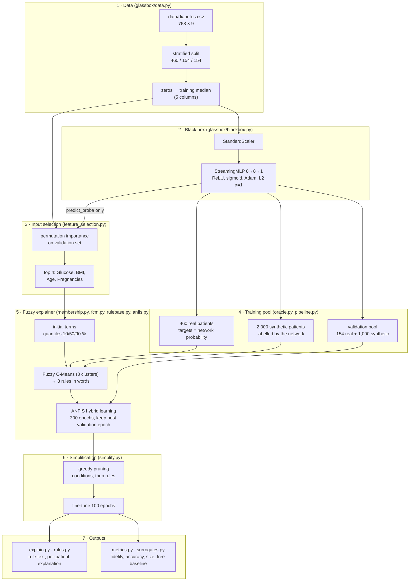
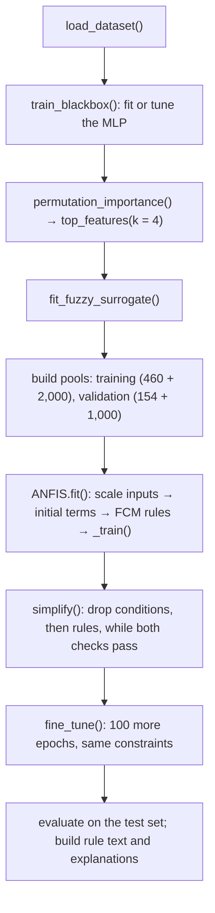

# Chapter 5 · Our Solution: From Idea to Architecture

[← Chapter 4](04-existing-approaches.md) · [Guide index](README.md) · [Next: Mathematics →](06-mathematics.md)

## 5.1 The central idea in plain English

> Ask the network what it thinks about many patients, real and synthetic.
> Teach a small fuzzy rule system to give the same answers. Keep its words
> honest. Delete everything it does not need. Then use the rules to explain any
> decision.

## 5.2 How the method addresses the problem

| Problem | Mechanism |
|---|---|
| Network is opaque | A readable surrogate imitates it; the network's internals are never needed. |
| Surrogate must be faithful | Trained on the network's probabilities; extra synthetic patients labelled by the network; early stopping on a validation pool; fidelity checked during pruning. |
| Surrogate must be small | FCM proposes about 8 rules instead of 81; greedy pruning removes conditions and rules. |
| Words must keep their meaning | Shared terms; shoulders at the ends; constraints on drift, ordering, gap and width. |
| Decisions must be traceable | Output = Σ weight × rule output: an exact per-rule decomposition, plus a weak-match flag. |

## 5.3 System architecture

*Figure 5.1. Implemented architecture. Every box is code in the repository.* ✅

## 5.4 Step-by-step flow of one complete run

The entry points that run this flow are `glassbox/pipeline.py::train_glassbox`
(used by `scripts/make_guide_figures.py`), `scripts/run_experiments.py::main`
(all report results) and `webapp/jobs.py::_run` (the live lab, which runs the
same steps one by one so it can report progress). ✅

## 5.5 The components one by one

| # | Component | Purpose | Inputs → Outputs | Internal operation | Why needed | Code |
|---|---|---|---|---|---|---|
| 1 | Data loader | Clean, split, impute | CSV → 6 arrays + medians | stratified 60/20/20; zeros in 5 columns → median of non-zero training values | Garbage in, garbage out; avoid test leakage | `data.py::load_dataset`, `fit_imputer`, `apply_imputer` |
| 2 | Black box | The model to explain | 8 raw values → P(diabetic) | standardise → 8 ReLU → sigmoid; Adam; L2 | Something to explain | `blackbox.py::make_mlp`, `tune_mlp`, `BlackBox` |
| 3 | Importance | Find what the network relies on | network + validation data → ranking | shuffle one column, measure the average change in output, 30 repeats | Short rules need few inputs | `feature_selection.py::permutation_importance`, `top_features` |
| 4 | Oracle sampling | More training data for the copy | real patients → synthetic patients + network labels | real patient + Gaussian noise (0.15 × std), clipped to the range | Better imitation near the boundary | `oracle.py::oracle_augment` |
| 5 | Initial terms | Define Low/Medium/High | one scaled column → 3 centres, widths | quantiles 10/50/90 %; neighbours cross at 0.5 | A starting meaning for each word | `membership.py::initial_partition` |
| 6 | FCM rule proposal | Propose rules from data | (inputs, network output) → rule matrix | soft clustering → snap each centre to its best term → merge duplicates | Avoid an 81-rule grid | `fcm.py::fuzzy_c_means`, `rulebase.py::fcm_rules` |
| 7 | ANFIS | Learn the fuzzy system | pool + rules → tuned $c, \sigma, p$ | 5 layers; least squares for $p$; Adam on $c, \sigma$; constraints; best validation epoch | The neuro-fuzzy core | `anfis.py::ANFIS.fit`, `_train` |
| 8 | Pruning | Shorten the rule base | model → smaller model + log | try every deletion, keep the best if fidelity ≥ start − 1 pt and error ≤ 1.25 × start | Readability | `simplify.py::simplify` |
| 9 | Fine-tuning | Recover after pruning | pruned model → re-tuned model | 100 more epochs of `_train` | Pruning shifts the optimum | `anfis.py::ANFIS.fine_tune` |
| 10 | Rule text | Turn the model into sentences | model → strings/tables | term names + centres in original units | Human output | `rules.py::rule_text`, `rule_table` |
| 11 | Explanation | Explain one patient | model + patient → memberships, weights, contributions, match strength | exact decomposition $y = \sum_r \bar w_r p_r$ | Local traceability | `explain.py::explain_instance` |
| 12 | Evaluation | Measure faithfulness and size | predictions → metrics | fidelity (overall, boundary, confident), accuracy, size, tree baseline | Evidence | `metrics.py`, `surrogates.py`, `scripts/run_experiments.py` |
| 13 | Live lab | Demo everything live | browser settings → streamed events | background thread + server-sent events | Viva demonstration | `webapp/jobs.py`, `webapp/server.py`, `webapp/static/` |

## 5.6 Where fuzzy logic and where learning happen

| Stage | Fuzzy logic? | Learning / optimisation? |
|---|---|---|
| Black box | no | ✅ backpropagation with Adam (scikit-learn) |
| Importance | no | no (measurement only) |
| FCM | ✅ fuzzy clustering (soft memberships) | ✅ alternating optimisation of the FCM objective |
| ANFIS layers 1–3 | ✅ fuzzification, product AND, normalisation | ✅ centres and widths by gradient descent (our Adam) |
| ANFIS layers 4–5 | ✅ Sugeno weighted average | ✅ rule outputs by regularised least squares |
| Pruning | ✅ edits fuzzy rules | ✅ greedy combinatorial search |
| Explanation | ✅ firing strengths, memberships | no |

## 5.7 Ideal (proposed) vs implemented architecture

| Aspect | Ideal or proposed | Implemented | Gap |
|---|---|---|---|
| Rules from clustering the "input/activation space" | possibly the network's hidden activations | inputs + network output | Deliberate: keeps the method black-box. |
| Interpretability | judged by people | proxies: size, term drift and ordering | No user study. |
| All inputs in rules | 8 | 4 most important | 17 % of measured importance left out. |
| Number of terms | could be learned | fixed at 3 (2 also supported) | Not optimised. |
| Rule validation | against domain intuition | authors' judgement; no clinician | Expert review missing. |
| Baselines | – | decision-tree surrogate (and logistic regression for accuracy) | No LIME/SHAP/Anchors comparison. |
| Datasets | "real-world tabular dataset" | one dataset | No second dataset. |

## 5.8 What remains unsolved

- Whether people actually understand or trust these rules (needs a user study).
- Whether results transfer to other datasets or larger networks.
- Some learned terms overlap heavily (BMI 37 is Low 0.52 and High 0.53 at the same
  time), which weakens their meaning ([Chapter 11](11-results-critique.md)).
- About 15 % of test patients have no well-fitting rule (weak match).

[Next: Chapter 6 · Mathematics →](06-mathematics.md)
