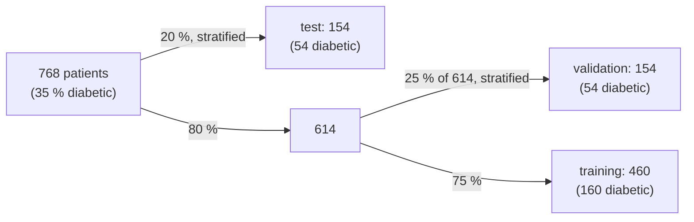

# Chapter 7 · Dataset, Features and Preprocessing

[← Chapter 6](06-mathematics.md) · [Guide index](README.md) · [Next: Code walkthrough →](08-code-walkthrough.md)

## 7.1 Where the data comes from

- **Name:** Pima Indians Diabetes dataset, file `data/diabetes.csv`. ✅
- **Origin:** collected by the US National Institute of Diabetes and Digestive and
  Kidney Diseases; first published by Smith et al. (1988); widely distributed
  through the UCI Machine Learning Repository and Kaggle. ✅ (`data/README.md`)
  The copy in this repository was downloaded from a public mirror (plotly's
  datasets repository) during development. 🔎
- **One row** = one woman of Pima Indian heritage, aged 21 or older. **Target:**
  whether she was diagnosed with diabetes. ✅
- **Size:** 768 rows × 9 columns; **no duplicate rows**. ✅
- **Licence and consent:** ❓ not documented in the repository. The dataset is
  public and widely used for teaching; mention that, but do not claim a specific
  licence.

## 7.2 The columns

| Column | Meaning | Unit | Range in data | Median | Role | Zeros |
|---|---|---|---|---|---|---|
| Pregnancies | number of times pregnant | count | 0–17 | 3 | input (used by rules) | 111 (**real** zeros) |
| Glucose | plasma glucose 2 h after an oral glucose tolerance test | mg/dL | 0–199 | 117 | input (used by rules) | 5 (**missing**) |
| BloodPressure | diastolic blood pressure | mm Hg | 0–122 | 72 | input | 35 (missing) |
| SkinThickness | triceps skin-fold thickness | mm | 0–99 | 23 | input | 227 (missing) |
| Insulin | 2-hour serum insulin | µU/mL | 0–846 | 30.5 | input | **374** (missing) |
| BMI | body mass index (weight / height²) | kg/m² | 0–67.1 | 32.0 | input (used by rules) | 11 (missing) |
| DiabetesPedigreeFunction | score of diabetes history among relatives | – | 0.08–2.42 | 0.37 | input | 0 |
| Age | age | years | 21–81 | 29 | input (used by rules) | 0 |
| **Outcome** | 1 = diabetic, 0 = not | – | 0/1 | – | **target of the network** | – |

✅ (computed from the CSV)

**Important:** the fuzzy explainer's target is **not** `Outcome`. It is the
**network's probability**. `Outcome` is used to train the network and to report
accuracy. (One control experiment trains the explainer on `Outcome`.)

## 7.3 Why the four rule inputs were chosen

They were **not** chosen by medical judgement. They are the four inputs the
*network* relies on most, measured by permutation importance on the validation
set: ✅

| Rank | Feature | Importance | Share | Medical plausibility 🔎 |
|---|---|---|---|---|
| 1 | Glucose | 0.231 | 43.8 % | the main diagnostic signal (an oral glucose tolerance test) |
| 2 | BMI | 0.110 | 20.8 % | obesity is a known risk factor for type 2 diabetes |
| 3 | Age | 0.051 | 9.7 % | risk rises with age |
| 4 | Pregnancies | 0.045 | 8.6 % | gestational diabetes and parity are associated with later diabetes |
| 5 | Pedigree | 0.043 | 8.2 % | family history (left out, just below the cut) |
| 6 | BloodPressure | 0.024 | 4.5 % | |
| 7 | Insulin | 0.016 | 3.1 % | mostly imputed, so it carries little signal |
| 8 | SkinThickness | 0.007 | 1.3 % | about 30 % imputed |

The medical-plausibility column is general background, not something the
project tested. The cut at 4 inputs is a hyperparameter (`N_FEATURES = 4`); the
feature-count study tried 2 to 6 inputs and found 4 best on average (94.8 %),
though the differences are small (92.9 %–94.8 %). ✅

## 7.4 Data-quality problems and what the code does about them

| Problem | Evidence | Handling | Code |
|---|---|---|---|
| **Impossible zeros** (glucose 0, BMI 0 …) mean "not measured" | 5 columns; 376 of 768 rows (49 %) have at least one such zero | replace with the **median of the non-zero training values** | `data.py::fit_imputer`, `apply_imputer` |
| Pregnancies = 0 | 111 rows | **kept**: zero pregnancies is a real value | `config.ZERO_MEANS_MISSING` excludes it |
| Heavy missingness in Insulin (49 %) and SkinThickness (30 %) | counts above | imputed like the others | 🔎 this weakens these features; the network barely uses them |
| Outliers (Insulin up to 846, SkinThickness 99) | ranges above | **not** removed or clipped | ❓ not analysed |
| Duplicates | none | – | – |
| Class imbalance (35 % diabetic) | 268 / 768 | **not** re-balanced; stratified splits keep the ratio | `train_test_split(..., stratify=y)` |

Imputation medians (from the training split only): Glucose 117, BloodPressure 72,
SkinThickness 30, Insulin 125, BMI 32.4. ✅

**Real example of imputation:** test patient #0 (CSV data row 44, the 46th line
of the file counting the header): Pregnancies 7, Glucose 159, BP 64,
SkinThickness **0**, Insulin **0**, BMI 27.4, Pedigree 0.294, Age 40. After
imputation: SkinThickness **30**, Insulin **125**; everything else unchanged. ✅

**Why median imputation?** It is simple and explainable, and robust to outliers
(unlike the mean). The alternatives (dropping rows, which would lose 49 % of the
data, or model-based imputation) were not tried. 🔎 A limitation: imputing 49 %
of Insulin values with one number makes that feature nearly uninformative.

## 7.5 Splits and leakage protection

✅ (`data.py::load_dataset`, `random_state = 42`)

| Leakage risk | Protection |
|---|---|
| Imputation medians using test data | medians are fitted on the training split only ✅ |
| Network scaler using test data | `StandardScaler` is inside the scikit-learn `Pipeline`, fitted on training data only ✅ |
| Hyperparameters tuned on test data | network: 5-fold CV inside the training set; ANFIS: validation pool ✅ |
| Pruning decisions using test data | validation pool only ✅ |
| Test patients in the synthetic data | synthetic patients come from training patients (training pool) and validation patients (validation pool) ✅ |
| Validation set used several times (importance, early stopping, pruning) | 🔎 a mild optimism risk for validation-based numbers. That is why only **test** numbers are reported as results. |

## 7.6 Scaling and transformation

| Model | Transformation | Fitted on | Code |
|---|---|---|---|
| Network | standardisation: $(x - \text{mean})/\text{std}$ per feature | training split | `blackbox.py::make_mlp` (`StandardScaler`) |
| ANFIS | min–max to [0, 1] | training pool; synthetic points are clipped to the training range, so this is the real training min and max | `anfis.py::fit` (`lo_`, `hi_`) |

No encoding is needed: every feature is numeric. ✅

## 7.7 How the data enters the models

1. **Network:** all 8 imputed features of the 460 training patients, with
   `Outcome` as the label.
2. **Explainer training pool:** the 4 selected features of 460 real + 2,000
   synthetic patients (2,460 × 4); target = the network's probability for each.
3. **Explainer validation pool:** 154 real + 1,000 synthetic validation patients;
   target = the network's probability; used for early stopping and pruning.
4. **Test:** 154 real patients; the network's decision is the "label" for
   fidelity, and `Outcome` for accuracy. ✅ (`pipeline.py::fit_fuzzy_surrogate`)

## 7.8 Class balance and what it means for metrics

- Test set: 54 diabetic, 100 not. **Always answering "non-diabetic" scores 64.9 %
  accuracy.** The network's 70.1 % is about 5 points above that trivial rule.
- The network calls 67.5 % of test patients non-diabetic, so a trivial explainer
  that always gives that answer would already have **67.5 % fidelity**. That is the
  real floor for judging our 92.2 %. ✅

[Next: Chapter 8 · Code walkthrough →](08-code-walkthrough.md)
