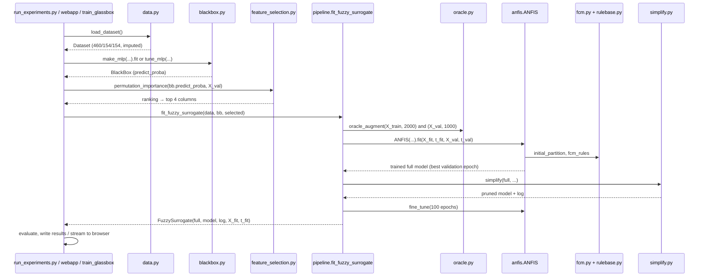

# Chapter 8 · Complete Code Walkthrough

[← Chapter 7](07-data.md) · [Guide index](README.md) · [Next: Training & evaluation →](09-training-evaluation.md)

Line numbers below were checked against the code at the time of writing. If you
edit a file, they may shift; function names are the stable reference.

---

## 8.1 Directory map

```
Fuzzy_Project/
├── data/diabetes.csv            the dataset (768 × 9)            data/README.md describes it
├── glassbox/                    the library (all modelling code, NumPy + scikit-learn)
│   ├── config.py                every setting in one place
│   ├── data.py                  load, split 60/20/20, impute zeros
│   ├── blackbox.py              the neural network (StreamingMLP) and CV tuning
│   ├── feature_selection.py     permutation importance
│   ├── oracle.py                synthetic patients labelled by the network
│   ├── membership.py            Gaussian terms with shoulders, initial partition
│   ├── fcm.py                   Fuzzy C-Means from scratch
│   ├── rulebase.py              rule matrix, grid rules, FCM rules
│   ├── anfis.py                 ANFIS: 5 layers, hybrid learning, constraints
│   ├── simplify.py              greedy pruning
│   ├── rules.py                 rules → sentences and tables
│   ├── explain.py               per-patient explanations, match strength
│   ├── metrics.py               fidelity, accuracy, size
│   ├── surrogates.py            decision-tree baseline
│   ├── plots.py                 report figures
│   └── pipeline.py              end-to-end training used by everything else
├── scripts/
│   ├── run_experiments.py       reproduces every result in results/
│   └── make_guide_figures.py    figures for this guide
├── webapp/                      the live lab (FastAPI server + HTML/JS page)
├── tests/                       26 automated tests
├── results/                     generated tables, rules, case studies, figures
└── docs/                        problem statement, methodology, viva guide, this guide
```

**Languages and libraries** ✅ (`requirements.txt`): Python 3.10+ (tested on
3.10 and 3.13), NumPy, pandas, scikit-learn (the network, cross-validation,
decision tree, metrics), Matplotlib (figures), FastAPI + uvicorn (lab server),
httpx and pytest (tests). The lab's browser side is plain HTML, CSS and
JavaScript with no external libraries. **ANFIS, Fuzzy C-Means, membership
functions, pruning and the Adam optimiser for ANFIS are written from scratch in
NumPy**; scikit-learn is used only for the network, splitting, CV, the tree and
metrics.

## 8.2 Execution order



---

## 8.3 `config.py`: all settings

- **Purpose:** one place for every constant (paths, feature list, units, split
  sizes, grids, fuzzy hyperparameters).
- **Key values** ✅: `SEED = 42`; `N_FEATURES = 4`; `N_TERMS = 3`; `N_RULES = 8`;
  `ANFIS_EPOCHS = 300`; `ANFIS_LR = 0.01`; `SIMPLIFY_TOLERANCE = 0.01`;
  `SIMPLIFY_MSE_GROWTH = 0.25`; `FINE_TUNE_EPOCHS = 100`; `ORACLE_SAMPLES = 2000`;
  `ORACLE_NOISE = 0.15`; network grid of hidden sizes {(8), (16), (16,8), (32,16)}
  × α {0.001, 0.01, 0.1, 1.0}.
- **Rationale:** reproducibility and one place to change things for the viva.

## 8.4 `data.py`: load, split, impute

```python
def fit_imputer(X_train: pd.DataFrame) -> dict:
    return {
        col: float(X_train.loc[X_train[col] != 0, col].median())
        for col in config.ZERO_MEANS_MISSING
    }
```

- **Purpose:** turn the CSV into clean train/validation/test arrays without leakage.
- **Inputs → outputs:** CSV path, seed → a `Dataset` dataclass (`X_train` 460×8,
  `y_train`, `X_val` 154×8, `y_val`, `X_test` 154×8, `y_test`, `feature_names`, `medians`).
- **Operations:** `load_raw` checks the columns; `load_dataset` makes two
  stratified `train_test_split` calls (test 20 %, then validation 25 % of the
  remaining 80 %); `fit_imputer` computes training medians of non-zero values;
  `apply_imputer` replaces zeros.
- **Syntax notes:** `X_train.loc[X_train[col] != 0, col]` selects the rows where
  the column is non-zero; the `{col: ... for col in ...}` expression is a
  dictionary comprehension.
- **Rationale:** stratification keeps 35 % diabetic in every split; training-only
  medians avoid leakage.
- **Potential issues:** zeros are detected by exact equality, which is fine for
  this CSV; no outlier handling; 49 % of Insulin values become one number.

## 8.5 `blackbox.py`: the neural network

```python
class StreamingMLP(MLPClassifier):
    on_epoch = None
    def _update_no_improvement_count(self, *args, **kwargs):
        super()._update_no_improvement_count(*args, **kwargs)
        if self.on_epoch is not None:
            self.on_epoch(self, self.n_iter_)
```

- **Purpose:** build, tune and wrap the black box.
- **`make_mlp(hidden, alpha, seed)`:** returns a scikit-learn `Pipeline` of
  `StandardScaler` → `StreamingMLP(activation="relu", solver="adam",
  learning_rate_init=1e-3, max_iter=500)`.
- **`StreamingMLP`:** identical to scikit-learn's `MLPClassifier`, except that it
  calls `on_epoch` after each epoch, so the live lab can stream the loss curve.
  scikit-learn has no callback API, so the class overrides a method scikit-learn
  calls once per epoch. With `on_epoch` unset nothing changes; we verified the
  probabilities are identical. ✅
- **`tune_mlp`:** `GridSearchCV` over 16 settings, 5-fold stratified CV, scored
  by ROC-AUC, then refits the best setting on all training data. Chosen: 8 hidden
  neurons, α = 1.0 (CV AUC 0.826). ✅
- **`BlackBox`:** a thin wrapper exposing `predict_proba` (P(diabetic)) and
  `predict` (threshold 0.5). **The rest of the project only ever calls these
  two methods**: the black-box assumption.
- **Potential issues:** (1) `_update_no_improvement_count` is a *private*
  scikit-learn method and could change in a future version (it works on 1.7 and
  1.9 ✅). (2) α = 1.0 is the **largest value in the grid**, so a wider grid might
  find a better setting. 🔎 (3) There was no class re-weighting, so recall is
  modest (0.54).

## 8.6 `feature_selection.py`: what the network relies on

```python
for j, name in enumerate(feature_names):
    for _ in range(n_repeats):
        Xp = X.copy()
        Xp[:, j] = rng.permutation(Xp[:, j])
        changes.append(np.mean(np.abs(predict_proba(Xp) - base)))
```

- **Purpose:** rank inputs by how much the *network's output* moves when each is
  shuffled (§6.19). Uses only `predict_proba`, so it is model-agnostic.
- **Inputs → outputs:** predict function, validation data → a table of
  importance, standard deviation and share; `top_features` returns column
  indices [1, 5, 7, 0] = Glucose, BMI, Age, Pregnancies. ✅
- **Potential issues:** correlated inputs (Age and Pregnancies) can make
  shuffling create unrealistic patients; only 154 validation rows.

## 8.7 `oracle.py`: synthetic patients

```python
base = X[rng.integers(0, len(X), n_samples)]
synthetic = base + rng.normal(0.0, 1.0, base.shape) * noise * X.std(axis=0)
synthetic = np.clip(synthetic, X.min(axis=0), X.max(axis=0))
return synthetic, oracle_fn(synthetic)
```

- **Purpose:** more training data for imitation, labelled by the network (§6.20).
- **Rationale:** the target *is* the network, so its answer on any input is
  correct by definition for our purpose. The ablation shows +1.3 points of fidelity. ✅
- **Potential issues:** noise is added to each feature independently (it ignores
  correlations); Pregnancies becomes non-integer; clipping piles points at the edges.

## 8.8 `pipeline.py`: the orchestrator

```python
if target == "nn":
    X_fit = data.X_train
    t_fit = blackbox.predict_proba(data.X_train)
    if oracle_samples:
        X_syn, t_syn = oracle_augment(data.X_train, blackbox.predict_proba, oracle_samples, seed=seed)
        X_fit, t_fit = np.vstack([X_fit, X_syn]), np.concatenate([t_fit, t_syn])
```

- **Purpose:** one function (`fit_fuzzy_surrogate`) that every entry point uses,
  so the report, the figures and the lab build identical models.
- **Inputs:** data, black box, selected columns, hyperparameters, optional
  `on_progress` callback (used only by the lab).
- **Operations:** build the training pool (2,460 × 4) and validation pool
  (1,154 × 4) with network probabilities as targets (or true labels if
  `target="truth"`) → `ANFIS(...).fit` → `simplify` → `fine_tune`.
- **Output:** `FuzzySurrogate(selected, full, model, simplify_log, X_fit, t_fit)`.
  `X_fit`/`t_fit` are kept so edited rule bases can be re-fitted in the lab.
- **`train_glassbox`:** convenience wrapper: data → network → importance →
  surrogate.

## 8.9 `membership.py`: terms

```python
d = np.asarray(X, dtype=float)[:, :, None] - np.asarray(centers)[None]
if d.shape[2] > 1:
    d[:, :, 0] = np.maximum(d[:, :, 0], 0.0)      # below the Low centre: offset 0, mu = 1
    d[:, :, -1] = np.minimum(d[:, :, -1], 0.0)    # above the High centre: offset 0, mu = 1
```

- **Purpose:** the offsets $d$ (§6.3) and log-memberships for all patients,
  inputs and terms at once (array shape `(n, k, m)`).
- **Syntax:** `[:, :, None]` adds a new axis so NumPy *broadcasts*: every value
  minus every centre, with no Python loops.
- **`initial_partition`:** quantile centres and the half-membership width (§6.2).

## 8.10 `fcm.py` and `rulebase.py`: proposing rules

- **`fuzzy_c_means(X, n_clusters, m=2, tol=1e-6, seed)`:** random initial
  memberships (Dirichlet, so each row sums to 1) → alternate the centre and
  membership updates (§6.5) → stop when memberships change by less than $10^{-6}$
  or after 300 iterations. Returns centres, memberships, iteration count and the
  objective history.
- **`fcm_rules`:** clusters `[scaled inputs, target]`; orders clusters by size;
  for each centre picks the best term per input; skips duplicates. Output: an
  integer matrix (≤ 8 rules × 4).
- **`grid_rules(k, m)`:** all $m^k$ combinations, used for the grid reference.
- **`unique_rules`:** removes duplicate rows, keeping the original order.
- **Potential issues:** snapping a centre to the nearest term discards detail;
  FCM depends on its random start (handled with a seed and the 5-seed sweep).

## 8.11 `anfis.py`: the core

The class `ANFIS` holds hyperparameters in `__init__` and learned state in
attributes ending with `_` (scikit-learn style):

| Attribute | Shape (main model) | Meaning |
|---|---|---|
| `lo_`, `hi_`, `span_` | (4,) | scaling to [0, 1] |
| `centers_`, `sigmas_` | (4, 3) | premise parameters (scaled units) |
| `initial_centers_`, `initial_sigmas_` | (4, 3) | starting values, used by the constraints |
| `antecedents_` | (4, 4) after pruning | rule matrix, −1 = don't care |
| `consequents_` | (4,) | rule outputs $p_r$ |
| `prior_` | scalar | mean target, 0.352 (used by the ridge term) |
| `history_` | dict of lists | training and validation MSE per epoch |
| `fcm_`, `initial_antecedents_` | – | what FCM produced (shown in the lab) |

**The training loop** (`_train`, lines 261–290), annotated:

```python
for epoch in range(1, epochs + 1):
    wbar = self._normalize(self._log_firing(Xn))                     # layers 1-3
    self.consequents_ = self._solve_consequents(wbar, Xn, target)    # forward pass: least squares
    y = np.sum(wbar * self._rule_outputs(Xn), axis=1)                # layers 4-5
    self.history_["train"].append(float(np.mean((y - target) ** 2)))
    if has_val:                                                      # early stopping bookkeeping
        val_loss = float(np.mean((self._raw_output(Xn_val) - target_val) ** 2))
        ...keep a copy of the parameters if val_loss is the best so far...
    grad_c, grad_s = self._premise_gradients(Xn, wbar, y, target)   # backward pass
    optimizer.step([self.centers_, self.sigmas_], [grad_c, grad_s])  # Adam
    self._apply_constraints()                                        # projection
```

After the loop, the best-validation copy is restored (lines 286–289).

| Method | Equation (Chapter 6) | Lines |
|---|---|---|
| `_scale` | §6.1 | 106 |
| `_log_memberships` | §6.3 | 118–121 |
| `_log_firing` | §6.6 | 123–135 |
| `_normalize` | §6.7 | 137–140 |
| `_rule_outputs` | §6.8 / §6.17 | 143–147 |
| `_solve_consequents` | §6.10 | 150–171 |
| `_premise_gradients` | §6.11 | 173–198 |
| `Adam.step` | §6.12 | 54–64 |
| `_apply_constraints` | §6.13 | 200–214 |
| `fit` | §6.1, 6.2, 6.5 then `_train` | 216–250 |
| `fine_tune` | `_train` again | 252–259 |
| `predict_proba`, `predict` | §6.8 | 300–305 |
| `with_antecedents` | copy + re-fit $p$ (used by pruning and the editor) | 323–327 |

- **Complexity per epoch:** $O(N \cdot R \cdot k)$ for firing strengths plus
  $O(N R^2 + R^3)$ for least squares, with $N$ = 2,460, $R$ ≤ 16, $k$ = 4. That is
  milliseconds; a full run takes about 5 seconds. ✅ (measured in the lab)
- **Potential issues:** full-batch training (fine at this size); clipping $p$
  makes least squares projected; re-sorting centres does not reorder Adam's
  internal moments (rarely matters); the grid option is slow for many inputs.

## 8.12 `simplify.py`: pruning

```python
for description, A in edits(model):
    fid, mse, candidate = _score(model, A, X_train, t_train, X_val, nn_val_labels)
    if fid >= floor and mse <= mse_limit and (best is None or (fid, -mse) > (best[0], -best[1])):
        best = (fid, mse, candidate, description)
```

- **Purpose:** greedy best-first deletion of conditions, then rules (§6.15).
- **`(fid, -mse) > (best[0], -best[1])`:** Python compares tuples element by
  element: higher fidelity wins, and ties are broken by lower MSE.
- **Cost:** every candidate re-fits least squares; the main model needs a few
  hundred candidate evaluations, a couple of seconds in total.
- **Potential issues:** greedy is not guaranteed optimal; the result depends on
  the tie-break order.

## 8.13 `rules.py` and `explain.py`: turning numbers into words

- `condition_text` → "Glucose is High (~155 mg/dL)": the term name plus its centre
  in original units.
- `rule_text` → "IF … AND … THEN risk = 0.85 (very high risk -> Diabetic)".
  `risk_label` bands: < 0.2 very low, < 0.4 low, < 0.6 uncertain, < 0.8 high,
  else very high. These bands are for reading only; the decision uses 0.5.
- `rule_table` → coverage (share of patients for whom the rule has the largest
  weight) and average weight.
- `explain_instance` → memberships, rules sorted by weight, each rule's
  contribution, match strength and `weak_match`.

## 8.14 `metrics.py` and `surrogates.py`

- `fidelity`, `fidelity_by_confidence` (boundary = network probability within
  0.15 of 0.5), `probability_mae`, `classification_metrics` (scikit-learn
  accuracy, precision, recall, F1, ROC-AUC), and `anfis_complexity` (rules,
  conditions, average rule length, THEN-part parameters).
- `fit_tree_surrogate(X, nn_labels, max_rules)`: a `DecisionTreeClassifier` with
  `max_leaf_nodes = max_rules` and `min_samples_leaf = 5`; `tree_complexity`
  counts each leaf as a rule whose length is its depth.
- **Potential issue (important):** the tree is trained on the **460 real training
  patients with hard labels**, while ANFIS gets **2,460 points with soft targets**.
  The comparison favours ANFIS (see [Chapter 11](11-results-critique.md)).

## 8.15 `scripts/run_experiments.py`: reproducing the report

Seven stages, printed as it runs: (1) tune the network and fit logistic
regression; (2) permutation importance; (3) main explainer, rules and figures;
(4) case studies; (5) trade-off sweep (9 sizes × 5 seeds + trees + grid
references); (6) ablations and the feature-count study; (7) `summary.md` and
`metrics.json`. All files are written as UTF-8. Runs in about 5 minutes
(`--quick` uses 1 seed).

## 8.16 `webapp/`: the live lab

- `server.py`: FastAPI endpoints: start a run, stream events, predict, view or
  replace the rule base.
- `jobs.py`: runs the same pipeline in a background thread, recording an event
  per network epoch, ANFIS epoch and pruning step; slow motion adds short sleeps.
  With default settings it reproduces the report's main model exactly. ✅ (tested)
- `static/`: the page. `app.js` draws events; `charts.js` contains hand-written
  canvas charts.
- **Potential issues:** runs are kept in memory only (they are lost on restart);
  no authentication (it listens on 127.0.0.1 only, so this is fine for a local demo).

## 8.17 Tests (26 in total)

| File | What it checks |
|---|---|
| `test_data.py` | split sizes and stratification; no impossible zeros remain; the imputer uses only non-zero training values |
| `test_fcm.py` | memberships sum to 1; two separated blobs are found; the objective never increases |
| `test_anfis.py` | initial terms cross at 0.5; shoulders; normalised weights sum to 1; output = weighted average; **analytic gradient = numerical gradient**; learns a threshold rule; constraints hold; don't-care works; FCM rule count; first-order fits a linear target |
| `test_metrics_and_rules.py` | fidelity maths; rule text; contributions sum to the output; pruning reduces size within tolerance; first-order rule text |
| `test_webapp.py` | config validation; a run streams every stage; predictions decompose exactly; rule edits re-fit and are validated |

## 8.18 Tracing one patient through the actual code

Patient #152 (CSV data row 425):

| Stage | Function | Data at this point |
|---|---|---|
| Raw | `load_raw` | `[4, 184, 78, 39, 277, 37.0, 0.264, 31]`, Outcome 1 |
| Preprocessed | `apply_imputer` | unchanged (no zeros) |
| Network input | `StandardScaler` | `[0.07, 2.13, 0.50, 1.03, 1.76, 0.66, -0.65, -0.18]` |
| Network output | `BlackBox.predict_proba` | 0.837 → Diabetic |
| Explainer input | columns [1, 5, 7, 0] | `[184, 37, 31, 4]` |
| Scaled | `ANFIS._scale` | `[0.908, 0.385, 0.167, 0.286]` |
| Layer 1 | `memberships` | 4×3 matrix (Chapter 12) |
| Layers 2–3 | `firing_strengths` | w = `[0.0074, 0.0052, 0.0026, 0.9327]`, w̄ = `[0.008, 0.005, 0.003, 0.984]` |
| Layers 4–5 | `predict_proba` | 0.843 → Diabetic (agrees) |
| Explanation | `explain_instance` | top rule R4 with contribution 0.838; match 0.93 (good) |

✅ (all values printed from the real model)

## 8.19 How to run everything

```bash
python -m venv .venv && source .venv/bin/activate   # Windows: py -m venv .venv ; .venv\Scripts\Activate.ps1
python -m pip install -r requirements.txt
python -m pytest                       # expect: 26 passed
python scripts/run_experiments.py      # regenerates results/ (about 5 min; --quick for 1 seed)
python scripts/make_guide_figures.py   # regenerates docs/guide/figures/
python -m webapp                       # live lab at http://127.0.0.1:8000
```

**Expected inputs:** only `data/diabetes.csv`. **Expected outputs:** `results/`
(markdown, CSV, JSON, PNG). The webapp needs no files beyond the code.
**Common errors** (from the README troubleshooting table): `python` not found
on Windows (use `py`); PowerShell blocks `Activate.ps1` (run
`Set-ExecutionPolicy -Scope CurrentUser RemoteSigned`); `ModuleNotFoundError: glassbox`
(run from the project folder); port 8000 busy (`python -m webapp --port 8001`).

[Next: Chapter 9 · Training & evaluation →](09-training-evaluation.md)
