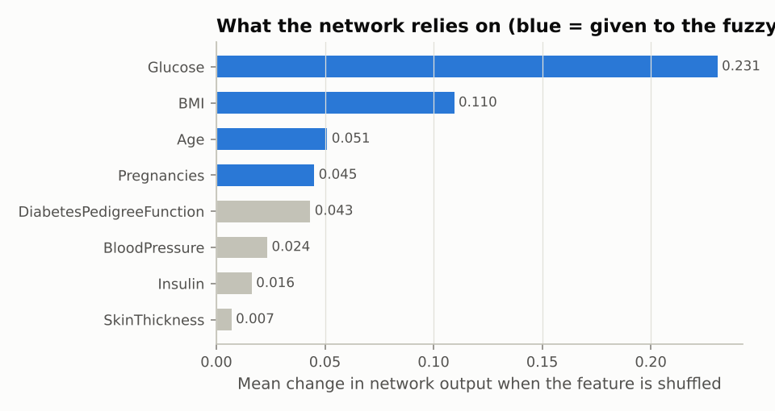
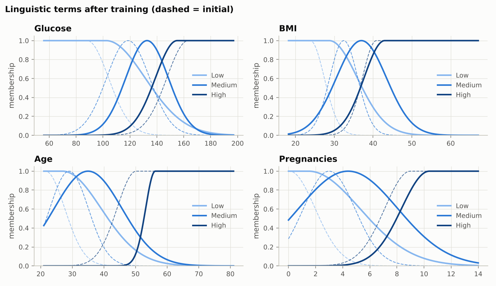
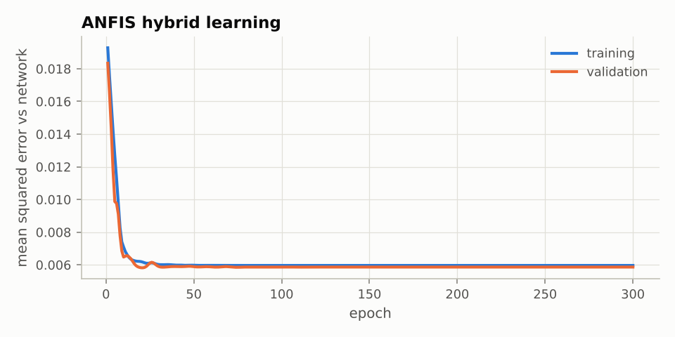
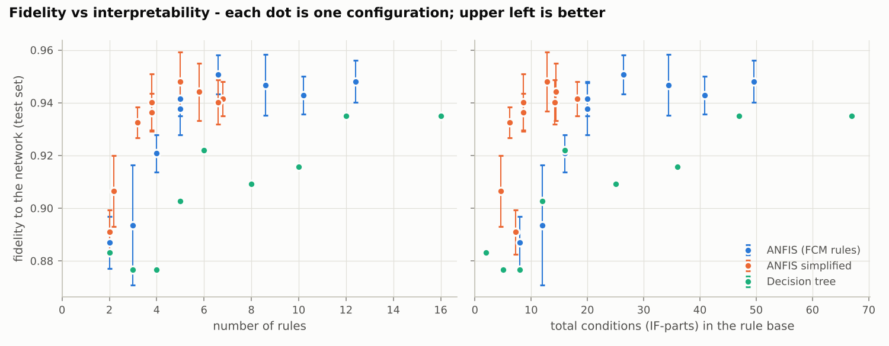

# Chapter 11 · Results, Limitations and Critical Analysis

[← Chapter 10](10-traceability.md) · [Guide index](README.md) · [Next: Worked example →](12-worked-example.md)

All numbers come from `results/summary.md` and the other files in `results/`,
generated by `python scripts/run_experiments.py`, unless marked otherwise. ✅

---

## 11.1 Experiment by experiment

### E1 · Training and tuning the black box
- **Objective:** a reasonable network to explain.
- **Setup:** 16 settings, 5-fold CV on 460 patients, ROC-AUC.
- **Result:** 8 hidden neurons, α = 1.0; test accuracy 70.1 %, F1 0.558, AUC 0.797.
  Logistic regression: 70.8 %, F1 0.545, AUC 0.817.
- **Interpretation:** the network is about as good as a linear model, and about
  5 points above always answering "non-diabetic" (64.9 %).
- **Limits:** α = 1.0 is at the edge of the grid; one data split; 154 test patients.

### E2 · What the network relies on

- **Result:** Glucose 44 %, BMI 21 %, Age 10 %, Pregnancies 9 %; the four
  dropped inputs together 17 %.
- **Interpretation:** glucose dominates, which is plausible for an oral glucose
  tolerance test.
- **Limits:** permutation importance is unreliable with correlated inputs;
  measured on 154 validation patients.

### E3 · The main explainer (seed 42)

- **Result:** before pruning 8 rules / 32 conditions / 94.8 % fidelity; after
  pruning 4 rules / 12 conditions / **92.2 %**. Boundary fidelity 71.4 % (35
  patients), confident fidelity 98.3 % (119 patients). Probability gap (MAE) 0.072.
- **Interpretation:** almost all disagreements are near the network's decision
  boundary, where its surface bends.
- **Limits:** one seed; this seed pruned harder than average.

### E4 · Case studies
Five test patients (`results/case_studies.md`): a confident diabetic (#152), a
confident non-diabetic (#29), a borderline patient (#75; network 0.50), an
unusual patient (#108, weak match 0.00), and a disagreement (#89; network 0.26,
explainer 0.58).
- **Interpretation:** typical patients are explained by one dominant rule;
  boundary and unusual patients show the method's limits honestly.
- **Limits:** chosen by rules in the script (most confident, closest to 0.5, …),
  not at random.

### E5 · Fidelity vs interpretability trade-off

- **Setup:** FCM clusters 2–16 × seeds 0–4, before and after pruning; trees with
  the same number of leaves.
- **Result (selected):**

  | FCM clusters | Full: conditions → fidelity | Pruned: conditions → fidelity | Tree: leaves / conditions → fidelity |
  |---|---|---|---|
  | 2 | 8.0 → 88.7 % | 7.2 → 89.1 % | 2 / 2 → 88.3 % |
  | 4 | 16.0 → 92.1 % | 6.2 → 93.2 % | 4 / 8 → 87.7 % |
  | 8 | 26.4 → 95.1 % | 12.8 → 94.8 % | 8 / 25 → 90.9 % |
  | 16 | 49.6 → 94.8 % | 14.2 → 94.0 % | 16 / 67 → 93.5 % |

- **Interpretation:** fidelity rises quickly up to about 12 conditions and then
  plateaus around 94–95 %. Pruning keeps fidelity while cutting conditions by
  half or more. Fuzzy rules sit above trees at every size.
- **Limits:** trees trained on less data with hard labels; not significant per
  comparison (McNemar p = 0.21 at 4 rules; [Chapter 9](09-training-evaluation.md)).

### E6 · Grid ANFIS reference
- **Result:** 2 terms → 16 rules / 64 conditions / 93.5 %; 3 terms → 81 rules /
  324 conditions / 94.2 %.
- **Interpretation:** the classic grid gains nothing over ~5 pruned rules, at
  25× the size.

### E7 · Ablations (seeds 0–4, pruned)

| Variant | Fidelity | Conditions | Drift | Ordered | Reading |
|---|---|---|---|---|---|
| Full method | 94.8 % | 12.8 | 0.10 | 100 % | reference |
| No oracle sampling | 93.5 % | 11.0 | 0.10 | 100 % | synthetic data helps +1.3 pts |
| No constraints | 94.2 % | 12.4 | **0.50** | **60 %** | constraints cost no fidelity but keep meaning |
| Trained on true labels | **88.2 %** | 11.2 | 0.08 | 100 % | imitating the network matters |
| First-order THEN-parts | 94.3 % | 5.2 (18 THEN numbers) | 0.10 | 100 % | linear outputs are not more faithful |

- **Limits:** "No oracle" has std 0.000 because only FCM randomness varies
  between seeds; 5 seeds is few.

### E8 · Number of inputs (2–6)
- **Result:** 92.9 %, 93.4 %, **94.8 %**, 93.6 %, 92.9 %; a grid would need 9 to
  729 rules, while ours stays at 4–5.
- **Interpretation:** 4 inputs is a reasonable choice; differences are small.

### E9 · Live lab consistency check
- With default settings, the lab reproduces the main model exactly (4 rules,
  12 conditions, 92.2 %). ✅ (tested during development; `tests/test_webapp.py`
  checks that runs complete and explanations decompose)

---

## 11.2 Weaknesses, by area

| Area | Weakness | Severity |
|---|---|---|
| Data | One small dataset (768); 49 % of rows had missing values; Insulin mostly imputed; outliers untreated | high |
| Black box | No better than logistic regression; α at the grid edge; no class weighting (recall 0.54) | medium |
| Experimental method | One train/val/test split; 154 test patients (1 patient = 0.65 pts); no significance tests in the main script; tree baseline trained on less data | **high** |
| Interpretability | Widths may double, so terms overlap: BMI 37 is Low 0.52 *and* High 0.53; Glucose 140 is still 0.43 "Low"; Age 31 is Low 0.95 and Medium 0.93 | **high** for the viva |
| Interpretability | Only proxies (counts, drift); no user study; validated by the authors' judgement only | high |
| Coverage | 15 % of test patients have no well-fitting rule | medium |
| Fidelity | Boundary fidelity only 71 % | medium (inherent) |
| Optimisation | Early stopping chose epoch 21 of 300, so most epochs were wasted; greedy pruning is not optimal | low |
| Reproducibility | Some design claims rest on development runs that are not saved (network early stopping; pruning without the error check) | low–medium |
| Code | The streaming hook overrides a private scikit-learn method | low |
| Scope | 4 of 8 inputs (17 % of importance excluded) | low |

## 11.3 Recommended improvements, in priority order

### Achievable in days

1. **Fair tree baseline.**
   *Problem:* the tree had 460 hard labels while ANFIS had 2,460 soft targets.
   *Change:* train the tree (or a regression tree on probabilities) on the same
   pool, in `surrogates.py` and `run_experiments.py`.
   *Why:* removes the main objection to the comparison.
   *Measure:* fidelity at equal size; report both versions.
2. **Uncertainty and significance.**
   *Problem:* small test set.
   *Change:* add a McNemar test and bootstrap 95 % confidence intervals for
   fidelity; repeat the whole pipeline over 5–10 different data splits.
   *Measure:* confidence intervals that do not overlap, or an honest statement
   that they do.
3. **Distinguishability of terms.**
   *Problem:* overlapping terms (BMI 37 is both Low and High).
   *Change:* tighten the width range (for example 0.75–1.5×) or add a constraint
   such as "a term's membership at a neighbour's centre ≤ 0.5"; report an
   overlap metric.
   *Measure:* overlap metric down; fidelity change within the seed spread.
4. **Wider network grid and class weights.**
   *Problem:* α at the grid edge; low recall.
   *Change:* α ∈ {1, 3, 10}; `class_weight`-style re-weighting (scikit-learn's MLP
   has none, so weight samples instead).
   *Measure:* CV AUC; test recall.
5. **Save the development comparisons.**
   *Problem:* unverifiable claims in docstrings.
   *Change:* add them as ablations in `run_experiments.py`.
   *Measure:* numbers appear in `summary.md`.

### Achievable in weeks

6. **Compare with local explainers** (SHAP, LIME, Anchors) on local fidelity and
   explanation size.
7. **A second dataset** (for example another public tabular medical or
   credit-risk dataset) to test generality.
8. **Choose the number of clusters and terms automatically** (for example the
   fuzzy partition coefficient, already implemented in `fcm.py::partition_coefficient`
   but unused, or validation fidelity).

### Longer-term research directions

9. **User study:** do clinicians or students answer questions about the
   network's behaviour more accurately with the rules than without?
10. **Explanation stability:** different seeds give different rule bases with
    similar fidelity. Measure rule overlap across seeds and favour stable rules.
11. **Linguistic outputs** (Mamdani-style "risk is High") and type-2 fuzzy sets
    for uncertainty in the terms themselves.
12. **Larger black boxes** (deeper networks, gradient-boosted trees).

[Next: Chapter 12 · Worked example →](12-worked-example.md)
