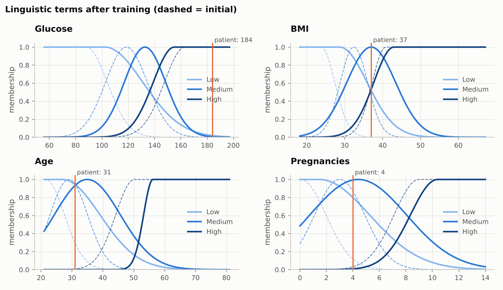

# Chapter 12 · Complete End-to-End Worked Example (real values)

[← Chapter 11](11-results-critique.md) · [Guide index](README.md) · [Next: Viva questions →](13-viva-questions.md)

**Every number here comes from the trained main model** (report settings, seed 42),
printed by running the project's own functions. Small differences in the last
digit are rounding. ✅ You can reproduce it in the live lab: open *Explore*; the
default patient is #152.

---

## Step 0 · The question

A 31-year-old woman with 4 pregnancies has these measurements. Does the network
think she is diabetic, and **why**?

## Step 1 · Raw input

From `data/diabetes.csv`, data row 425 (test patient #152 after the split):

| Pregnancies | Glucose | BloodPressure | SkinThickness | Insulin | BMI | Pedigree | Age | Outcome |
|---|---|---|---|---|---|---|---|---|
| 4 | 184 mg/dL | 78 mm Hg | 39 mm | 277 µU/mL | 37.0 | 0.264 | 31 | **1 (diabetic)** |

*What the system knows:* eight numbers. The outcome is hidden from both models
and used only to score them.

## Step 2 · Preprocessing

None of the five "zero means missing" columns is zero, so imputation changes
nothing. *(For a patient with missing values, see Chapter 7: test patient #0's
missing SkinThickness and Insulin become 30 and 125.)*

## Step 3 · The black box decides

**3a. Standardise** with the training mean and standard deviation, for example
glucose: $(184 - 121.81)/29.23 = 2.13$.

| | Preg | Glu | BP | Skin | Ins | BMI | Ped | Age |
|---|---|---|---|---|---|---|---|---|
| standardised | 0.07 | 2.13 | 0.50 | 1.03 | 1.76 | 0.66 | −0.65 | −0.18 |

**3b. Hidden layer** (8 ReLU neurons): activations
$h = (0,\ 1.636,\ 0,\ 1.591,\ 0,\ 0,\ 0.409,\ 0)$. Three neurons are active.

**3c. Output neuron:** with output weights for neurons 2, 4, 7 of 0.453, 0.495,
−0.663 and bias 0.377:

$$z = 1.636(0.453) + 1.591(0.495) + 0.409(-0.663) + 0.377 = 1.634, \qquad \sigma(z) = \frac{1}{1+e^{-1.634}} = \mathbf{0.837}$$

**Network: P(diabetic) = 0.84 → Diabetic** (correct).

*Why this is not an explanation:* the numbers say that hidden neurons 2 and 4
pushed up and neuron 7 pushed down. No neuron corresponds to a human concept.

## Step 4 · The explainer's view: four inputs, scaled

The explainer uses only Glucose, BMI, Age and Pregnancies, scaled with the
training-pool minimum and maximum:

| | Glucose | BMI | Age | Pregnancies |
|---|---|---|---|---|
| value | 184 | 37.0 | 31 | 4 |
| range (lo–hi) | 56–197 | 18.2–67.1 | 21–81 | 0–14 |
| scaled | 0.908 | 0.385 | 0.167 | 0.286 |

## Step 5 · Fuzzification (layer 1)

The trained terms, in original units (centre ± width):

| Input | Low (shoulder) | Medium | High (shoulder) |
|---|---|---|---|
| Glucose | 102.3 ± 29.0 | 132.7 ± 15.8 | 155.1 ± 16.2 |
| BMI | 28.7 ± 7.2 | 37.0 ± 6.5 | 43.0 ± 5.3 |
| Age | 26.9 ± 12.2 | 35.0 ± 10.7 | 56.3 ± 3.0 |
| Pregnancies | 1.5 ± 3.8 | 4.4 ± 3.7 | 10.4 ± 2.1 |

Three memberships worked out by hand (the ratio $d/\sigma$ is the same in
original and scaled units):

- **Glucose is High:** 184 is above the High centre 155.1. High is a shoulder,
  so $d = 0$ and $\mu = $ **1.00**.
- **Age is Medium:** $d = 31 - 35.0 = -4.0$; $\mu = e^{-0.5(4.0/10.71)^2} = e^{-0.070} = $ **0.933**.
- **BMI is Low:** 37 is above the Low centre 28.7, on the Gaussian side:
  $d = 8.3$; $\mu = e^{-0.5(8.3/7.24)^2} = e^{-0.657} = $ **0.519**.

All twelve:

| | Low | Medium | High |
|---|---|---|---|
| Glucose 184 | 0.019 | 0.005 | **1.000** |
| BMI 37.0 | 0.519 | **1.000** | 0.532 |
| Age 31 | 0.946 | 0.933 | 0.000 |
| Pregnancies 4 | 0.800 | 0.994 | 0.008 |

*Figure 12.1. Real: the trained terms (solid), their starting positions (dashed)
and patient #152 (orange line).*

*Notice:* BMI 37 is 0.52 "Low" and 0.53 "High" at the same time, as well as fully
"Medium". This is the term-overlap weakness discussed in Chapter 11.

## Step 6 · Rule firing (layer 2): AND = product

| Rule | Conditions | Product | $w_r$ |
|---|---|---|---|
| R1 | Glucose Low · BMI Low · Age Low · Preg Low | 0.019 × 0.519 × 0.946 × 0.800 | **0.0074** |
| R2 | Glucose Medium · Preg Medium | 0.005 × 0.994 | **0.0052** |
| R3 | Glucose Medium · BMI High · Age Medium | 0.005 × 0.532 × 0.933 | **0.0026** |
| R4 | Glucose High · BMI Medium · Age Medium | 1.000 × 1.000 × 0.933 | **0.9327** |

R4 fires strongly; every other rule is almost "off", mostly because this
patient's glucose is clearly not Low or Medium.

## Step 7 · Normalisation (layer 3)

$\sum w = 0.0074 + 0.0052 + 0.0026 + 0.9327 = 0.948$

| | R1 | R2 | R3 | R4 |
|---|---|---|---|---|
| $\bar w_r = w_r/0.948$ | 0.008 | 0.005 | 0.003 | **0.984** |

## Step 8 · Consequents and output (layers 4–5)

| Rule | $\bar w_r$ | $p_r$ (learned) | contribution $\bar w_r p_r$ |
|---|---|---|---|
| R1 | 0.008 | 0.033 | 0.0003 |
| R2 | 0.005 | 0.352 | 0.0019 |
| R3 | 0.003 | 0.853 | 0.0023 |
| R4 | 0.984 | 0.852 | **0.8384** |
| **Sum = output $y$** | | | **0.843** |

**Fuzzy explainer: risk 0.84 ≥ 0.5 → Diabetic.** Same decision as the network,
with almost the same probability (0.843 vs 0.837).

## Step 9 · How good is this explanation?

- **Match strength** = max raw firing = 0.933 ≥ 0.5 → **good match**: one rule
  describes this patient well.
- **Agreement:** yes (fuzzy 0.84 vs network 0.84).

## Step 10 · The explanation in words

> "The network predicts diabetes (0.84). The fuzzy explanation agrees (0.84).
> 98 % of the decision comes from one rule: **IF glucose is High (~155 mg/dL or
> more) AND BMI is Medium (~37) AND age is Medium (~35) THEN risk ≈ 0.85.** This
> patient matches it almost perfectly (glucose 184: fully High; BMI 37: fully
> Medium; age 31: Medium to degree 0.93)."

## Step 11 · What happens if glucose changes? (measured in the lab)

| Glucose | Network | Fuzzy | Rule with the largest weight |
|---|---|---|---|
| 184 | 0.84 | 0.84 | R4 Glucose High (0.98) |
| 150 | 0.66 | 0.66 | R4 (0.49), R2 Glucose Medium (0.30) |
| 130 | 0.46 | 0.51 | R2 (0.49): **the models disagree** |
| 110 | 0.26 | 0.33 | R1 Glucose Low (0.41), R2 (0.38) |

As glucose falls, the weight moves smoothly from "High" rules to "Medium" and
then "Low" rules. The single disagreement appears exactly where the network sits
at its decision boundary (0.46).

## Step 12 · How this example answers the original problem

| Original need | Shown here |
|---|---|
| The network gives no reason | Steps 3b–3c: only hidden-neuron numbers |
| Faithful approximation | Step 8: 0.843 vs 0.837, same decision |
| Human-readable rule | Step 10 |
| Traceability | Step 8: contributions add up exactly to the output |
| Honesty about limits | Step 9: match strength; Step 11: the boundary disagreement; Step 5: overlapping BMI terms |

[Next: Chapter 13 · Viva questions →](13-viva-questions.md)
