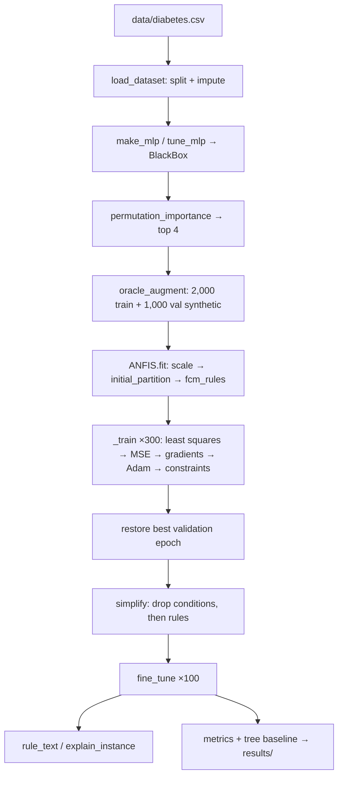

# Chapter 15 · Final Revision and Reference Sheets

[← Chapter 14](14-speaking-guide.md) · [Guide index](README.md)

---

## 15.1 One-page summary

**Title.** Glass-Box Insight: fuzzy rule extraction for explaining black-box
neural network decisions.

**Problem.** A neural network predicts diabetes but cannot explain its
decisions; we want a small, faithful, readable explanation.

**Data.** Pima Indians Diabetes: 768 women, 8 numeric measurements, 35 % diabetic.
Zeros in 5 columns are treated as missing and replaced by training medians.
Stratified 460/154/154 split.

**Black box.** MLP 8→8 ReLU→1 sigmoid, Adam, L2 α = 1.0, chosen by 5-fold CV;
70.1 % accuracy, AUC 0.80 (logistic regression 70.8 %; always-"no" 64.9 %).

**Explainer.** Zero-order Takagi-Sugeno ANFIS on the network's 4 most important
inputs (Glucose, BMI, Age, Pregnancies), 3 Gaussian terms each (shoulders for
Low and High). Rules proposed by Fuzzy C-Means (8 clusters). Trained on the
network's probabilities for 460 real + 2,000 synthetic patients by hybrid
learning (least squares for the rule outputs + Adam for centres and widths),
with constraints (drift ≤ 0.1, order, gap ≥ ½, width ½–2×) and best-validation-epoch
early stopping. Greedy pruning (fidelity −1 pt, error +25 %), then 100
fine-tuning epochs.

**Results.** 4 rules, 12 conditions, **92.2 % fidelity** on 154 unseen patients
(94.8 % ± 1.1 averaged over seeds 0–4); 4-leaf tree 87.7 % (McNemar p = 0.21);
grid ANFIS 94.2 % with 81 rules; constant answer 67.5 %. Ablations: true-label
training 88.2 %; no synthetic data 93.5 %; no constraints 94.2 % but terms drift
and swap; linear THEN-parts 94.3 % with 18 numbers after THEN. Exact per-patient
explanations; 15 % weak matches.

**Limits.** One dataset; small test set; the network ≈ logistic regression;
overlapping terms; proxies for interpretability; no clinician or user study; a
less-favoured tree baseline.

## 15.2 Glossary

| Term | Meaning |
|---|---|
| ANFIS | Adaptive Neuro-Fuzzy Inference System: a Sugeno fuzzy system as a 5-layer learnable network |
| Antecedent | the IF-part of a rule |
| Black box | a model we can query but not interpret |
| Consequent | the THEN-part of a rule (here one number $p_r$) |
| Constraint (ours) | a rule limiting how far the terms may move or change |
| Cross-validation | rotating train/score splits used to choose hyperparameters |
| Crisp set | a set with membership 0 or 1 only |
| Decision boundary | where the network's probability crosses 0.5 |
| Don't care (−1) | a rule ignores that input |
| Early stopping | keep the parameters from the best validation epoch |
| Epoch | one pass over the training data |
| FCM | Fuzzy C-Means: soft clustering |
| Fidelity | share of patients where the explainer's decision = the network's |
| Firing strength $w_r$ | product of a rule's memberships |
| Fuzzification | turning a number into membership degrees |
| Fuzzifier $m$ | FCM softness parameter (2) |
| Fuzzy set | a set with membership degrees in [0, 1] |
| Global surrogate | an interpretable model imitating a black box everywhere |
| Grid partition | every combination of terms as a rule ($m^k$ rules) |
| Hybrid learning | least squares for consequents + gradient descent for premises |
| Hyperparameter | a setting chosen before training |
| Imputation | filling in missing values |
| Linguistic term / variable | a word (High) / a variable described by words (Glucose) |
| L2 penalty α | a cost on large network weights |
| Match strength | raw firing strength of the best rule; weak if < 0.2 |
| Membership function | maps a value to a degree in [0, 1] |
| Normalised weight $\bar w_r$ | a rule's share of the decision |
| Oracle sampling | synthetic inputs labelled by the black box |
| Pedagogical rule extraction | learning rules from a model's input-output behaviour only |
| Permutation importance | output change when one input is shuffled |
| Premise parameters | membership-function centres and widths |
| Pruning | deleting conditions and rules that are not needed |
| ReLU / sigmoid | $\max(0,z)$ / $1/(1+e^{-z})$ |
| Ridge λ | penalty pulling rule outputs towards the average |
| Shoulder | an outer term that stays at 1 beyond its centre |
| Stratified split | each split keeps the class ratio |
| Takagi-Sugeno (zero-order) | rules with constant outputs, combined by a weighted average |
| t-norm | fuzzy AND (ours: product) |

## 15.3 Essential equations

| # | Equation | Symbols |
|---|---|---|
| E1 | $\tilde x_j = (x_j - \text{lo}_j)/(\text{hi}_j - \text{lo}_j)$ | scaling |
| E2 | $\mu_{jt} = \exp(-d_{jt}^2/2\sigma_{jt}^2)$, with $d$ clipped on the shoulder side | membership |
| E3 | $\sigma_j = \overline{\Delta c}/(2\sqrt{2\ln2})$ | initial width |
| E4 | $w_r = \prod_{j \in r} \mu_{j,A_{rj}}$ | firing strength |
| E5 | $\bar w_r = w_r / \sum_q w_q$ | normalisation |
| E6 | $y = \sum_r \bar w_r p_r$; diabetic if $y \ge 0.5$ | output |
| E7 | $L = \frac1N\sum_n (y_n - t_n)^2$, $t_n = f_{NN}(x_n)$ | ANFIS loss |
| E8 | $p = (\bar W^\top\bar W + \lambda I)^{-1}(\bar W^\top t + \lambda\bar t\mathbf 1)$, clipped to [0, 1] | least squares |
| E9 | $\partial y/\partial\theta = \sum_r \bar w_r (p_r - y)\,\partial\log w_r/\partial\theta$ | gradient core |
| E10 | $\partial\log\mu/\partial c = d/\sigma^2$, $\partial\log\mu/\partial\sigma = d^2/\sigma^3$ | Gaussian derivatives |
| E11 | Adam: $m, v$ moving averages; $\theta \mathrel{-}= \eta\,\hat m/(\sqrt{\hat v} + \epsilon)$ | optimiser |
| E12 | FCM: $v_i = \sum u^m z/\sum u^m$; $u_{ni} = 1/\sum_l (d_{ni}/d_{nl})^{2/(m-1)}$ | clustering |
| E13 | pruning accepts if $F \ge F_0 - 0.01$ and $E \le 1.25 E_0$ | simplification |
| E14 | fidelity $= \frac1{\lvert T\rvert}\sum \mathbb 1[\hat d_{FIS} = \hat d_{NN}]$ | evaluation |
| E15 | network: $\hat y = \sigma(w_2^\top \mathrm{ReLU}(W_1^\top \hat x + b_1) + b_2)$ | black box |

## 15.4 Implementation flowchart

## 15.5 Concept → code map

| Concept | File · function |
|---|---|
| Missing-value imputation | `data.py` · `fit_imputer`, `apply_imputer` |
| Stratified split | `data.py` · `load_dataset` |
| Neural network | `blackbox.py` · `make_mlp`, `StreamingMLP` |
| Cross-validation tuning | `blackbox.py` · `tune_mlp` |
| Permutation importance | `feature_selection.py` · `permutation_importance` |
| Oracle sampling | `oracle.py` · `oracle_augment` |
| Membership function, shoulders | `membership.py` · `term_offsets`, `log_memberships` |
| Initial terms | `membership.py` · `initial_partition` |
| Fuzzy C-Means | `fcm.py` · `fuzzy_c_means` |
| Rules from clusters | `rulebase.py` · `fcm_rules` |
| Grid rules | `rulebase.py` · `grid_rules` |
| Layers 1–3 | `anfis.py` · `_log_memberships`, `_log_firing`, `_normalize` |
| Layers 4–5 | `anfis.py` · `_rule_outputs`, `_raw_output`, `predict_proba` |
| Least squares | `anfis.py` · `_solve_consequents` |
| Gradients | `anfis.py` · `_premise_gradients` |
| Adam | `anfis.py` · `Adam` |
| Constraints | `anfis.py` · `_apply_constraints` |
| Early stopping | `anfis.py` · `_train` |
| Pruning | `simplify.py` · `simplify` |
| Rule sentences | `rules.py` · `rule_text`, `rule_table` |
| Explanation, match strength | `explain.py` · `explain_instance` |
| Fidelity, metrics | `metrics.py` |
| Tree baseline | `surrogates.py` · `fit_tree_surrogate` |
| Whole pipeline | `pipeline.py` · `fit_fuzzy_surrogate`, `train_glassbox` |
| All experiments | `scripts/run_experiments.py` |
| Live demo | `webapp/` |

## 15.6 The ten things every team member must understand

1. Fidelity is not accuracy; we are judged by fidelity.
2. The explainer is trained on the **network's probabilities**, not the true labels.
3. Fuzzy membership is a degree of fit, not a probability.
4. Our system is a **zero-order Takagi-Sugeno ANFIS**: five layers, product AND,
   weighted-average output.
5. Hybrid learning = least squares for $p$ + gradient descent for $c, \sigma$.
6. FCM proposes rules because a grid would need 81 (or 6,561).
7. Constraints and shoulders keep the words meaningful, at no cost in fidelity.
8. Pruning has two checks and is followed by fine-tuning.
9. The headline numbers: 92.2 % (main), 94.8 % ± 1.1 (5 seeds), 87.7 % tree,
   67.5 % constant, 70.1 % network accuracy.
10. The limitations, and the fix for each.

## 15.7 Twenty highest-priority viva questions

(Answers in [Chapter 13](13-viva-questions.md).)

1. What is your project in one sentence? (1.1)
2. Accuracy vs fidelity? (1.2)
3. Why train on the network's outputs? (2.1)
4. Mamdani or Sugeno, and why? (2.2)
5. Explain hybrid learning. (2.5)
6. Where do the rules come from? (2.6)
7. Why not a grid? (2.7)
8. What constraints, and why? (2.10)
9. How does pruning work? (2.12)
10. Is oracle sampling cheating? (2.14)
11. Walk me through the code. (3.1)
12. How do you know the gradient is right? (3.4)
13. Why explain a 70 %-accurate network? (4.1)
14. Is 92 % good? Compared to what? (4.2)
15. Is it significantly better than a tree? (4.3)
16. Are your terms really meaningful? (4.5)
17. What exactly is learned? (5.3)
18. What is the strongest limitation? (5.8)
19. What would you do with another month? (5.9)
20. What did you implement, modify or omit from the proposal? (5.10)

## 15.8 Claims to verify before presenting

| # | Claim | Status | Action |
|---|---|---|---|
| 1 | "Validation early stopping made the network unstable" (`make_mlp` docstring) | development observation, not saved ❓ | present as a design reason, not a result, or re-run it |
| 2 | "Without the error check, pruning fell from 94 % to 92 %" (`simplify.py` docstring, `METHODOLOGY.md`) | development runs, not reproduced by the script ❓ | same |
| 3 | Course-unit numbers in the proposal | not checkable here ❓ | check against your syllabus |
| 4 | Dataset licence / provenance details | not documented ❓ | cite Smith et al. (1988) and UCI/Kaggle availability |
| 5 | GDPR "right to explanation" | legally debated 🔎 | phrase as "pushes towards" |
| 6 | Whether your department expects a specific base paper | unknown ❓ | ask your guide |
| 7 | Medical plausibility of the rules | general knowledge, not tested 🔎 | say "consistent with common risk factors" |
| 8 | Novelty of the error check and weak-match flag | no literature search ❓ | do not claim novelty |
| 9 | Run time (~5 s per run, ~5 min for experiments) | measured on one machine | check on your laptop |
| 10 | The lab reproduces the report on your machine | verified on Python 3.10 and 3.13 here | run `python -m pytest` and one lab run before the viva |
| 11 | "Better than trees" | consistent but not significant | always add the caveat |

## 15.9 Known limitations, and safe ways to say them

| Limitation | Safe, honest phrasing |
|---|---|
| One small dataset | "Our conclusions are for this dataset; testing a second one is the next step." |
| Network ≈ logistic regression | "The network is typical for this data. Our method explains whatever model is given; it doesn't need an excellent one." |
| Small test set | "One patient is 0.65 points, so we report averages over seeds and treat small differences as inconclusive." |
| Not significant vs the tree | "Higher at every size we tried, but on its own not statistically significant (p = 0.21)." |
| Tree had less data | "Our baseline is a little favourable to us; a fairer version is our first improvement." |
| Overlapping terms | "Constraints keep the terms ordered, but they can widen too much; an overlap limit would fix that." |
| No user study | "We measure readability by size and term stability; whether people understand the rules better is untested." |
| 15 % weak matches | "For unusual patients the rules don't fit well, and the system says so instead of overclaiming." |
| 4 of 8 inputs | "The four inputs left out carry 17 % of the network's measured importance." |
| Boundary disagreements | "Near 0.5 the network's surface bends faster than a few rules can follow; that's where the 8 % of disagreements are." |

[← Back to the guide index](README.md)
