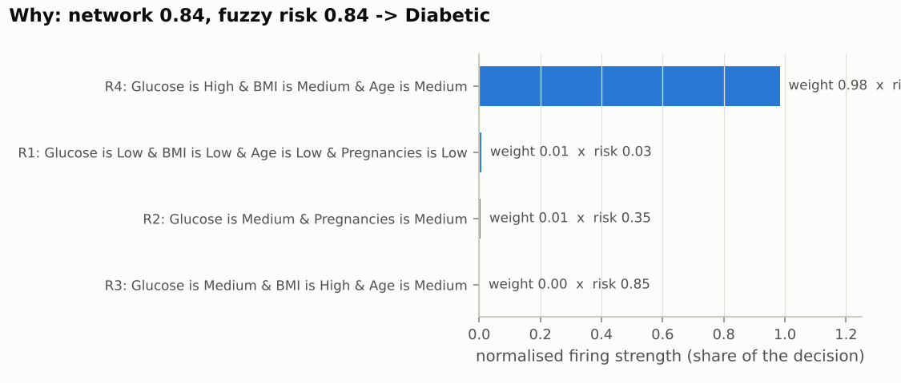
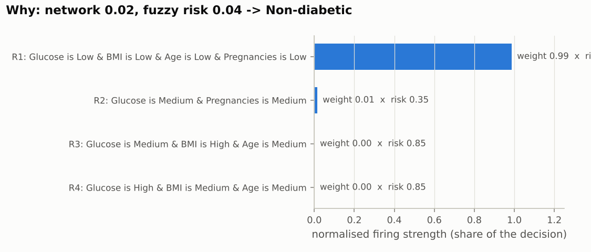
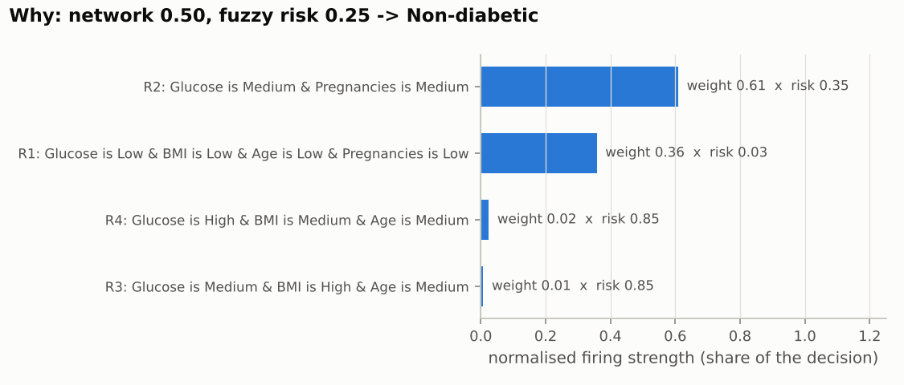
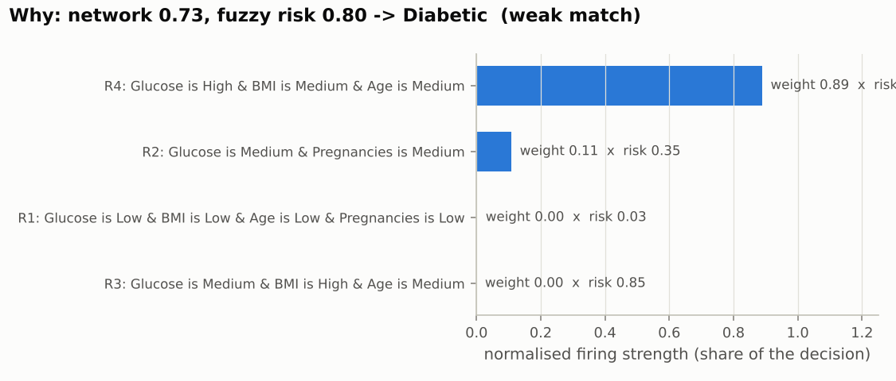
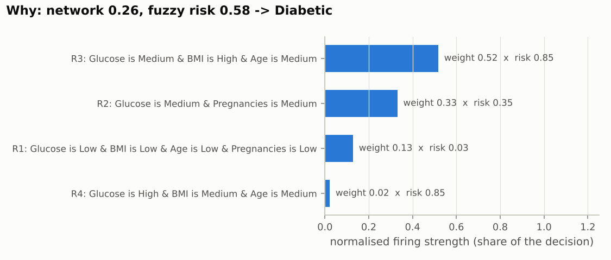

# Case studies (test-set patients)

Each case shows the patient, both models' outputs, how each input was fuzzified, and which rules produced the answer. *Match strength* is the raw firing strength of the best rule: below 0.2 the rule base has no good description of the patient.

### Confident Diabetic (test patient #152)

**Inputs used by the fuzzy system:** Glucose = 184, BMI = 37, Age = 31, Pregnancies = 4.00

- Neural network: P(diabetic) = 0.84 -> **Diabetic**
- Fuzzy system: risk = 0.84 -> **Diabetic** (agrees)
- Actual outcome: Diabetic
- Match strength (best rule's raw firing): 0.93

**Fuzzified inputs (degree of membership):**

- Glucose: Low 0.02, Medium 0.01, High 1.00
- BMI: Low 0.52, Medium 1.00, High 0.53
- Age: Low 0.95, Medium 0.93, High 0.00
- Pregnancies: Low 0.80, Medium 0.99, High 0.01

**Top 3 rules by weight:**

| Rule | Conditions (membership) | Weight | Rule output | Contribution |
|---|---|---|---|---|
| 4 | Glucose is High (1.00); BMI is Medium (1.00); Age is Medium (0.93) | 0.98 | 0.85 (very high risk) | 0.838 |
| 1 | Glucose is Low (0.02); BMI is Low (0.52); Age is Low (0.95); Pregnancies is Low (0.80) | 0.01 | 0.03 (very low risk) | 0.000 |
| 2 | Glucose is Medium (0.01); Pregnancies is Medium (0.99) | 0.01 | 0.35 (low risk) | 0.002 |

Other rules contribute 0.002; all contributions sum to the fuzzy output 0.84.

### Confident Healthy (test patient #29)

**Inputs used by the fuzzy system:** Glucose = 89, BMI = 28, Age = 21, Pregnancies = 1.00

- Neural network: P(diabetic) = 0.02 -> **Non-diabetic**
- Fuzzy system: risk = 0.04 -> **Non-diabetic** (agrees)
- Actual outcome: Non-diabetic
- Match strength (best rule's raw firing): 1.00

**Fuzzified inputs (degree of membership):**

- Glucose: Low 1.00, Medium 0.02, High 0.00
- BMI: Low 1.00, Medium 0.39, High 0.02
- Age: Low 1.00, Medium 0.43, High 0.00
- Pregnancies: Low 1.00, Medium 0.65, High 0.00

**Top 3 rules by weight:**

| Rule | Conditions (membership) | Weight | Rule output | Contribution |
|---|---|---|---|---|
| 1 | Glucose is Low (1.00); BMI is Low (1.00); Age is Low (1.00); Pregnancies is Low (1.00) | 0.99 | 0.03 (very low risk) | 0.032 |
| 2 | Glucose is Medium (0.02); Pregnancies is Medium (0.65) | 0.01 | 0.35 (low risk) | 0.005 |
| 3 | Glucose is Medium (0.02); BMI is High (0.02); Age is Medium (0.43) | 0.00 | 0.85 (very high risk) | 0.000 |

Other rules contribute 0.000; all contributions sum to the fuzzy output 0.04.

### Borderline (test patient #75)

**Inputs used by the fuzzy system:** Glucose = 119, BMI = 27, Age = 33, Pregnancies = 6.00

- Neural network: P(diabetic) = 0.50 -> **Non-diabetic**
- Fuzzy system: risk = 0.25 -> **Non-diabetic** (agrees)
- Actual outcome: Diabetic
- Match strength (best rule's raw firing): 0.62

**Fuzzified inputs (degree of membership):**

- Glucose: Low 0.85, Medium 0.69, High 0.08
- BMI: Low 1.00, Medium 0.31, High 0.01
- Age: Low 0.88, Medium 0.98, High 0.00
- Pregnancies: Low 0.49, Medium 0.91, High 0.10

**Top 3 rules by weight:**

| Rule | Conditions (membership) | Weight | Rule output | Contribution |
|---|---|---|---|---|
| 2 | Glucose is Medium (0.69); Pregnancies is Medium (0.91) | 0.61 | 0.35 (low risk) | 0.215 |
| 1 | Glucose is Low (0.85); BMI is Low (1.00); Age is Low (0.88); Pregnancies is Low (0.49) | 0.36 | 0.03 (very low risk) | 0.012 |
| 4 | Glucose is High (0.08); BMI is Medium (0.31); Age is Medium (0.98) | 0.02 | 0.85 (very high risk) | 0.021 |

Other rules contribute 0.007; all contributions sum to the fuzzy output 0.25.

### Unusual Patient (test patient #108)

**Inputs used by the fuzzy system:** Glucose = 194, BMI = 26, Age = 67, Pregnancies = 8.00

- Neural network: P(diabetic) = 0.73 -> **Diabetic**
- Fuzzy system: risk = 0.80 -> **Diabetic** (agrees)
- Actual outcome: Non-diabetic
- Match strength (best rule's raw firing): 0.00 - **weak: no rule describes this patient well**

**Fuzzified inputs (degree of membership):**

- Glucose: Low 0.01, Medium 0.00, High 1.00
- BMI: Low 1.00, Medium 0.24, High 0.01
- Age: Low 0.00, Medium 0.01, High 1.00
- Pregnancies: Low 0.23, Medium 0.62, High 0.51

**Top 3 rules by weight:**

| Rule | Conditions (membership) | Weight | Rule output | Contribution |
|---|---|---|---|---|
| 4 | Glucose is High (1.00); BMI is Medium (0.24); Age is Medium (0.01) | 0.89 | 0.85 (very high risk) | 0.758 |
| 2 | Glucose is Medium (0.00); Pregnancies is Medium (0.62) | 0.11 | 0.35 (low risk) | 0.038 |
| 1 | Glucose is Low (0.01); BMI is Low (1.00); Age is Low (0.00); Pregnancies is Low (0.23) | 0.00 | 0.03 (very low risk) | 0.000 |

Other rules contribute 0.000; all contributions sum to the fuzzy output 0.80.

### Disagreement (test patient #89)

**Inputs used by the fuzzy system:** Glucose = 114, BMI = 44, Age = 27, Pregnancies = 0.00

- Neural network: P(diabetic) = 0.26 -> **Non-diabetic**
- Fuzzy system: risk = 0.58 -> **Diabetic** (DISAGREES)
- Actual outcome: Non-diabetic
- Match strength (best rule's raw firing): 0.38

**Fuzzified inputs (degree of membership):**

- Glucose: Low 0.92, Medium 0.50, High 0.04
- BMI: Low 0.10, Medium 0.54, High 1.00
- Age: Low 1.00, Medium 0.76, High 0.00
- Pregnancies: Low 1.00, Medium 0.48, High 0.00

**Top 3 rules by weight:**

| Rule | Conditions (membership) | Weight | Rule output | Contribution |
|---|---|---|---|---|
| 3 | Glucose is Medium (0.50); BMI is High (1.00); Age is Medium (0.76) | 0.52 | 0.85 (very high risk) | 0.442 |
| 2 | Glucose is Medium (0.50); Pregnancies is Medium (0.48) | 0.33 | 0.35 (low risk) | 0.117 |
| 1 | Glucose is Low (0.92); BMI is Low (0.10); Age is Low (1.00); Pregnancies is Low (1.00) | 0.13 | 0.03 (very low risk) | 0.004 |

Other rules contribute 0.019; all contributions sum to the fuzzy output 0.58.

