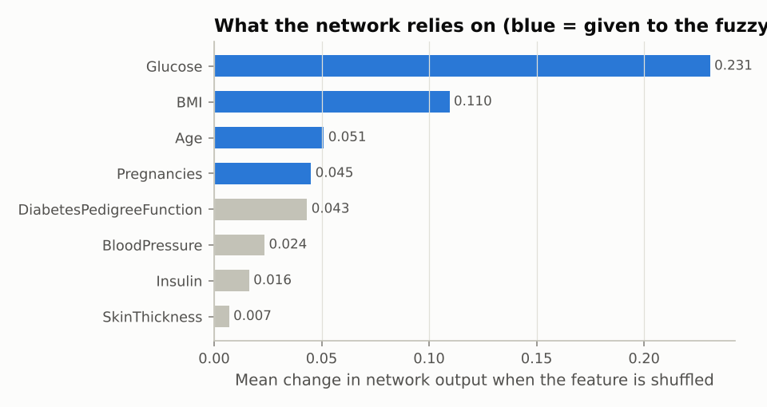
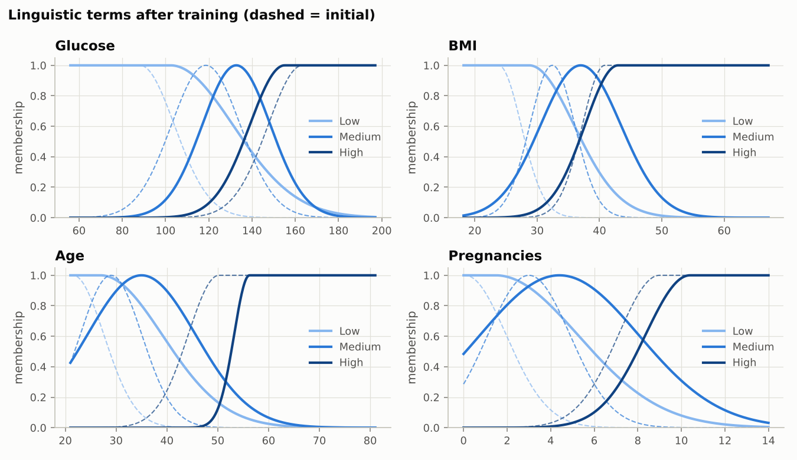
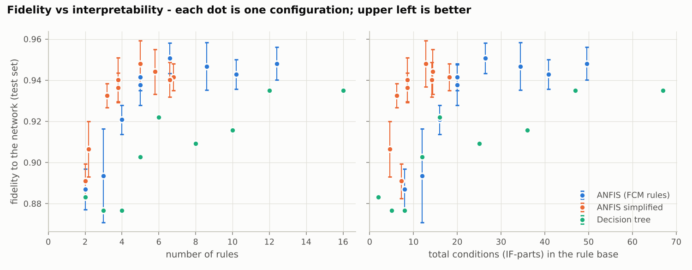

# Results summary

_Generated by `scripts/run_experiments.py` (full run,
5 seed(s), 353 s). Test set: 154 patients
never used for training, tuning or pruning._

## 1. Black-box neural network

MLP 8 -> 8 -> 1 (ReLU, sigmoid output), 81 trainable parameters, L2 alpha=1.0, trained for 321 epochs. Chosen by 5-fold cross-validation (top 5 of 16 settings):

| hidden layers | L2 alpha | CV ROC-AUC | std |
|---|---|---|---|
| (8,) | 1.000 | 0.826 | 0.017 |
| (16, 8) | 1.000 | 0.822 | 0.028 |
| (8,) | 0.010 | 0.822 | 0.016 |
| (8,) | 0.001 | 0.821 | 0.016 |
| (8,) | 0.100 | 0.821 | 0.017 |

Test-set performance against the true diagnosis:

| model | accuracy | f1 | roc_auc |
|---|---|---|---|
| Neural network (black box) | 0.701 | 0.558 | 0.797 |
| Logistic regression (reference) | 0.708 | 0.545 | 0.817 |
| Fuzzy explainer, full | 0.701 | 0.574 | 0.804 |
| Fuzzy explainer, simplified | 0.701 | 0.574 | 0.794 |

The network is about as accurate as logistic regression - typical for this small
tabular dataset. That does not matter for this project: the goal is to *explain*
whatever the network does, not to beat it.

## 2. What the network relies on



| feature | importance | share |
|---|---|---|
| Glucose | 0.231 | 0.438 |
| BMI | 0.110 | 0.208 |
| Age | 0.051 | 0.097 |
| Pregnancies | 0.045 | 0.086 |
| DiabetesPedigreeFunction | 0.043 | 0.082 |
| BloodPressure | 0.024 | 0.045 |
| Insulin | 0.016 | 0.031 |
| SkinThickness | 0.007 | 0.013 |

The fuzzy system uses the top 4: **Glucose, BMI, Age, Pregnancies**.

## 3. Fidelity of the fuzzy explainer (test set)

**Main model** (the one shown in rules.md, case studies and the demo; seed 42):

| stage | rules | conditions | avg_rule_length | fidelity | fidelity_boundary | fidelity_confident | prob_mae |
|---|---|---|---|---|---|---|---|
| full | 8 | 32 | 4.000 | 0.948 | 0.829 | 0.983 | 0.059 |
| simplified | 4 | 12 | 3.000 | 0.922 | 0.714 | 0.983 | 0.072 |

**Same setting averaged over 5 other seeds** ([0, 1, 2, 3, 4]; mean ± standard deviation).
Compare these two rows with each other, not with the main model above: a single run
can prune more or less aggressively than average.

| stage | rules | conditions | fidelity |
|---|---|---|---|
| before pruning | 6.6 ± 0.9 | 26.4 ± 3.6 | 0.951 ± 0.007 |
| after pruning | 5.0 ± 1.6 | 12.8 ± 5.0 | 0.948 ± 0.011 |

- *fidelity* = share of test patients where fuzzy decision = network decision
- *boundary / confident* = fidelity where the network's probability is within / outside 0.35-0.65
- *prob_mae* = mean |fuzzy risk - network probability|
- 15% of test patients have a *weak match* (no rule fires above
  0.2); their explanations are flagged as less reliable

The rules themselves are in [rules.md](rules.md); worked examples in
[case_studies.md](case_studies.md).



## 4. Fidelity vs interpretability trade-off



| method | target_rules | rules_mean | conditions_mean | fidelity_mean | fidelity_std | accuracy_mean |
|---|---|---|---|---|---|---|
| ANFIS (FCM rules) | 2 | 2.000 | 8.000 | 0.887 | 0.010 | 0.700 |
| ANFIS simplified | 2 | 2.000 | 7.200 | 0.891 | 0.008 | 0.704 |
| Decision tree | 2 | 2.000 | 2.000 | 0.883 | 0.000 | 0.675 |
| ANFIS (FCM rules) | 3 | 3.000 | 12.000 | 0.894 | 0.023 | 0.706 |
| ANFIS simplified | 3 | 2.200 | 4.600 | 0.906 | 0.013 | 0.704 |
| Decision tree | 3 | 3.000 | 5.000 | 0.877 | 0.000 | 0.721 |
| ANFIS (FCM rules) | 4 | 4.000 | 16.000 | 0.921 | 0.007 | 0.729 |
| ANFIS simplified | 4 | 3.200 | 6.200 | 0.932 | 0.006 | 0.725 |
| Decision tree | 4 | 4.000 | 8.000 | 0.877 | 0.000 | 0.721 |
| ANFIS (FCM rules) | 5 | 5.000 | 20.000 | 0.938 | 0.010 | 0.727 |
| ANFIS simplified | 5 | 3.800 | 8.600 | 0.940 | 0.011 | 0.717 |
| Decision tree | 5 | 5.000 | 12.000 | 0.903 | 0.000 | 0.708 |
| ANFIS (FCM rules) | 6 | 5.000 | 20.000 | 0.942 | 0.006 | 0.723 |
| ANFIS simplified | 6 | 3.800 | 8.600 | 0.936 | 0.007 | 0.721 |
| Decision tree | 6 | 6.000 | 16.000 | 0.922 | 0.000 | 0.714 |
| ANFIS (FCM rules) | 8 | 6.600 | 26.400 | 0.951 | 0.007 | 0.709 |
| ANFIS simplified | 8 | 5.000 | 12.800 | 0.948 | 0.011 | 0.706 |
| Decision tree | 8 | 8.000 | 25.000 | 0.909 | 0.000 | 0.714 |
| ANFIS (FCM rules) | 10 | 8.600 | 34.400 | 0.947 | 0.012 | 0.713 |
| ANFIS simplified | 10 | 5.800 | 14.400 | 0.944 | 0.011 | 0.708 |
| Decision tree | 10 | 10.000 | 36.000 | 0.916 | 0.000 | 0.708 |
| ANFIS (FCM rules) | 12 | 10.200 | 40.800 | 0.943 | 0.007 | 0.722 |
| ANFIS simplified | 12 | 6.800 | 18.200 | 0.942 | 0.006 | 0.713 |
| Decision tree | 12 | 12.000 | 47.000 | 0.935 | 0.000 | 0.714 |
| ANFIS (FCM rules) | 16 | 12.400 | 49.600 | 0.948 | 0.008 | 0.725 |
| ANFIS simplified | 16 | 6.600 | 14.200 | 0.940 | 0.008 | 0.704 |
| Decision tree | 16 | 16.000 | 67.000 | 0.935 | 0.000 | 0.714 |

Classic grid-partition ANFIS on the same 4 inputs (every combination of terms):

| method | rules | conditions | fidelity |
|---|---|---|---|
| ANFIS grid (2 terms) | 16 | 64 | 0.935 |
| ANFIS grid (3 terms) | 81 | 324 | 0.942 |

## 5. Ablation studies (simplified rule base, mean over seeds)

| variant | fidelity | fidelity_std | prob_mae | accuracy | rules | conditions | then_parameters | max_term_drift | ordered |
|---|---|---|---|---|---|---|---|---|---|
| Full method | 0.948 | 0.011 | 0.063 | 0.706 | 5.000 | 12.800 | 5.000 | 0.100 | 1.000 |
| No oracle sampling | 0.935 | 0.000 | 0.061 | 0.701 | 5.000 | 11.000 | 5.000 | 0.100 | 1.000 |
| No interpretability constraints | 0.942 | 0.008 | 0.058 | 0.716 | 4.200 | 12.400 | 4.200 | 0.495 | 0.600 |
| Trained on true labels (not the network) | 0.882 | 0.011 | 0.121 | 0.736 | 4.400 | 11.200 | 4.400 | 0.080 | 1.000 |
| First-order THEN-parts (linear formulas) | 0.943 | 0.010 | 0.055 | 0.712 | 3.600 | 5.200 | 18.000 | 0.100 | 1.000 |

- **No oracle sampling** - trained only on the 460 real training patients.
- **No interpretability constraints** - terms may move anywhere and swap order,
  so "Low" may no longer be low (see *max_term_drift*, as a fraction of the feature range).
- **Trained on true labels** - fidelity to the network drops: imitating the network
  and solving the task are different goals.
- **First-order THEN-parts** - each rule ends in a linear formula instead of one number
  (*then_parameters* counts the numbers a reader has to take in after THEN). Example:

  > IF Glucose is Low (~88 mg/dL) AND BMI is Low (~25 kg/m²) AND Age is Low (~28 yrs) THEN risk = 0.23 - 0.000922*Glucose - 0.00207*BMI - 0.00306*Age - 0.0324*Pregnancies

## 6. Number of input features

| features | grid_rules | rules | conditions | fidelity | accuracy |
|---|---|---|---|---|---|
| 2 | 9 | 3.800 | 5.600 | 0.929 | 0.726 |
| 3 | 27 | 5.400 | 13.200 | 0.934 | 0.718 |
| 4 | 81 | 5.000 | 12.800 | 0.948 | 0.706 |
| 5 | 243 | 4.400 | 13.800 | 0.936 | 0.721 |
| 6 | 729 | 4.000 | 14.800 | 0.929 | 0.716 |

*grid_rules* is how many rules a full grid ANFIS would need (3^k);
FCM initialisation plus pruning keeps the rule base small regardless of k.

## 7. Decision-tree surrogate at the same size

4 leaves, test fidelity
0.877:

```
|--- Glucose <= 132.5
|   |--- BMI <= 38.5
|   |   |--- class: 0
|   |--- BMI >  38.5
|   |   |--- class: 0
|--- Glucose >  132.5
|   |--- BMI <= 29.1
|   |   |--- class: 0
|   |--- BMI >  29.1
|   |   |--- class: 1
```
